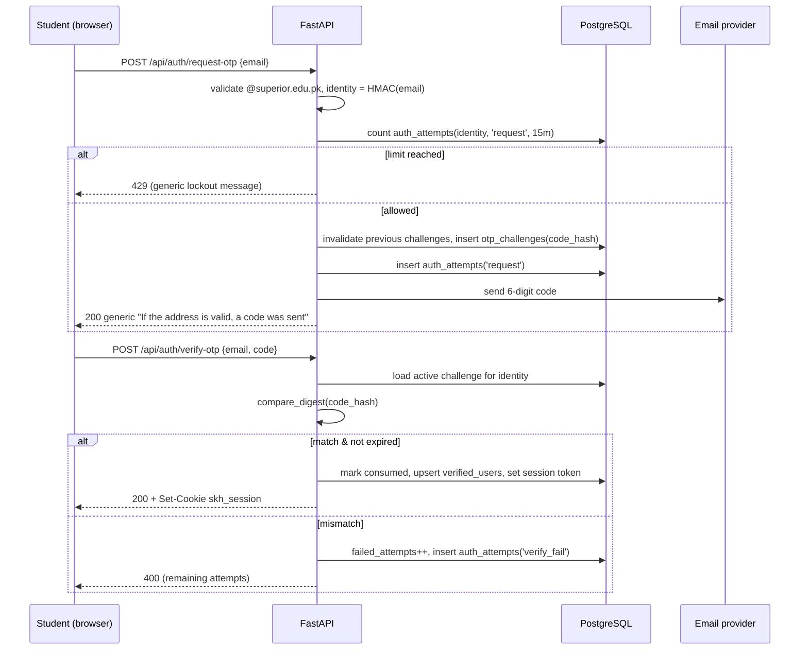
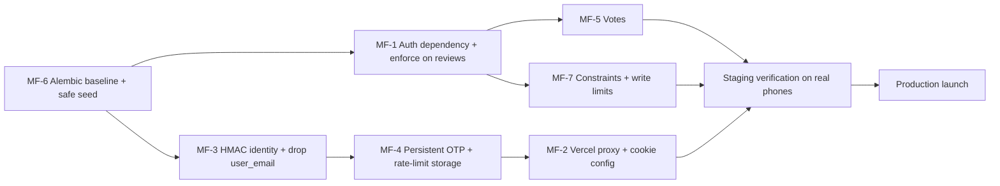

# PRD-01 — Backend Must-Fix Blockers (Production Readiness)

| Field | Value |
| :--- | :--- |
| **Product** | SirKaisaHai — Anonymous Teacher Reviews (Superior University, Phase 1) |
| **Component** | `backend/` (FastAPI + SQLAlchemy) with minor `sirkaisahai_first/` changes |
| **Document type** | Product Requirements Document (Engineering / Security) |
| **Status** | Draft — ready for implementation |
| **Priority** | **P0 — must ship before public launch to real students** |
| **Created** | 2026-11-21 |
| **Related** | `PRD-02-Backend-Missing-Product-Features.md` |

---

## 1. Summary

The backend works for local development, but it has **seven defects** that would cause one of three outcomes in production:

1. **Login breaks** (session cookie never reaches the API across domains).
2. **Anonymity or integrity is compromised** (unsalted email hashes, unauthenticated reviews, plaintext email audit log, unlimited upvotes).
3. **Data is lost or corrupted** (startup seed wipes the DB, in-memory OTP state vanishes on restart, race conditions create duplicates).

This PRD defines the required behavior, technical design, acceptance criteria, and test cases for each fix. All seven items are **launch blockers**.

| ID | Blocker | Impact if not fixed | Effort |
| :--- | :--- | :--- | :--- |
| **MF-1** | Enforce authentication on review submission | Anyone can post unlimited fake reviews via the API | S |
| **MF-2** | Production-safe session cookies & API routing | Students cannot stay logged in on the deployed site | S |
| **MF-3** | Keyed email hashing (HMAC) & remove plaintext email storage | Student identities can be recovered from the DB | M |
| **MF-4** | Persistent, secure OTP & rate-limit state | OTPs lost on redeploy; brute-force limits reset; weak RNG | M |
| **MF-5** | One helpful-vote per student per review | Vote counts are trivially inflatable | S |
| **MF-6** | Safe seeding & real DB migrations (Alembic) | A single missing row can wipe every review | M |
| **MF-7** | DB constraints, indexes & write rate limits | Duplicate reviews/teachers under concurrency; spam | S |

*Effort: S ≈ ≤ 1 day, M ≈ 1–3 days for one developer.*

---

## 2. Goals & Non-Goals

### Goals
- Make the backend safe to expose to the public internet for Superior University students.
- Guarantee the **anonymity promise** stated in the UI ("Your identity stays yours", "SHA-256 hashed", "Zero tracking", "Your name never appears") is technically true.
- Make the system survive restarts, redeploys and multiple workers without losing auth state.
- Make every write endpoint authenticated, idempotent where appropriate, and rate-limited.

### Non-Goals
- New product features (courses, moderation dashboard, AI summaries) — see **PRD-02**.
- Multi-university tenancy.
- Replacing FastAPI/SQLAlchemy or moving to async SQLAlchemy.

---

## 3. Guiding Constraints (apply to every item)

> [!IMPORTANT]
> **Anonymity invariant:** No table may contain data that lets anyone (including a DB admin) link a **review's text** to a **student identity** (email, email hash, user id, IP address, session token).

- **C-1** Plaintext student emails are never persisted server-side (DB, logs, error trackers).
- **C-2** `reviews` must never gain a column referencing `verified_users`, an IP, or a session.
- **C-3** Linkage tables (`teacher_submission_logs`, vote/report tables) must not store `review_id` alongside a user identifier.
- **C-4** Secrets come from environment variables; the app **refuses to start in production** with default/dev secrets.
- **C-5** Changes must be backward compatible with the current frontend unless a frontend change is explicitly listed.

---

## 4. Detailed Requirements

### MF-1 — Enforce Authentication on Review Submission

#### Problem
In [reviews.py](../backend/app/routers/reviews.py) (`submit_review`), the user is resolved from the `skh_session` cookie, then **falls back to hashing `payload.userEmail`** from the request body. If neither resolves, the code skips `if user:` and **still inserts the review**. Consequences:
- Unauthenticated scripts can post unlimited reviews (no `401`).
- Anyone can impersonate a verified student by sending their email in `userEmail`, consuming that student's one-review-per-teacher slot.

`POST /api/professors` already returns `401` correctly; reviews do not.

#### Requirements
| ID | Requirement |
| :--- | :--- |
| MF-1.1 | `POST /api/reviews` **must** return `401 Unauthorized` when there is no valid `skh_session` cookie mapped to a `verified_users` row. |
| MF-1.2 | The `userEmail` field must **not** be used for identity resolution anywhere in the backend (reviews and professors). It is accepted but ignored for one release, then removed from `ReviewCreate` / `ProfessorCreate`. |
| MF-1.3 | Cookie → user resolution is implemented once, as a reusable FastAPI dependency, and used by every authenticated route. |
| MF-1.4 | The one-review-per-teacher check runs **for every submission** (no `if user:` branch). |
| MF-1.5 | Frontend stops sending `userEmail` in `submitReview` and `addProfessor`. |

#### Technical Design
Create `backend/app/dependencies.py`:

```python
from fastapi import Depends, HTTPException, Request, status
from sqlalchemy.orm import Session
from app.database import get_db
from app.models import VerifiedUser

COOKIE_NAME = "skh_session"

def get_current_user_optional(request: Request, db: Session = Depends(get_db)) -> VerifiedUser | None:
    token = request.cookies.get(COOKIE_NAME)
    if not token or not token.startswith("skh-session-"):
        return None
    return db.query(VerifiedUser).filter(VerifiedUser.session_token == token).first()

def get_current_user(user: VerifiedUser | None = Depends(get_current_user_optional)) -> VerifiedUser:
    if user is None:
        raise HTTPException(status.HTTP_401_UNAUTHORIZED, "Verify your student email to continue.")
    return user
```

- `submit_review(..., user: VerifiedUser = Depends(get_current_user))`
- `create_professor(..., user: VerifiedUser = Depends(get_current_user))`
- `auth.get_current_user` (`GET /api/auth/me`) reuses `get_current_user_optional`.
- Remove the `hash_email(payload.userEmail)` fallback block entirely.

#### API Contract Change
| Endpoint | Before | After |
| :--- | :--- | :--- |
| `POST /api/reviews` without cookie | `200` (review saved) | `401 {"detail": "Verify your student email to continue."}` |
| `POST /api/reviews` with `userEmail` only | Resolves user from email | `401` (field ignored) |

#### Frontend Impact
- [SubmitReviewPage.vue](../sirkaisahai_first/src/pages/SubmitReviewPage.vue) (line ~102) and [SearchResultsPage.vue](../sirkaisahai_first/src/pages/SearchResultsPage.vue) (line ~105): remove `userEmail: authStore.email`.
- On `401`, redirect to `/auth?redirect=<current path>` (the auth flow already supports `redirect`).

#### Acceptance Criteria
- [ ] `curl -X POST /api/reviews` with a valid body and no cookie returns `401` and creates **zero** rows.
- [ ] Sending another student's email in `userEmail` without their cookie returns `401`.
- [ ] A verified student can still submit exactly one review per professor; the second attempt returns `400`/`409`.
- [ ] `grep -r "userEmail" backend/app` shows no identity-resolution usage.

#### Test Cases
| # | Scenario | Expected |
| :--- | :--- | :--- |
| T1 | No cookie | `401`, no `reviews` row, no `teacher_submission_logs` row |
| T2 | Invalid/expired token cookie | `401` |
| T3 | Valid cookie, first review for professor | `200`, 1 review + 1 log row |
| T4 | Valid cookie, second review same professor | `409` (see MF-7) |
| T5 | Logged-out token (after `/auth/logout`) | `401` |

---

### MF-2 — Production-Safe Session Cookies & API Routing

#### Problem
- [auth.py](../backend/app/routers/auth.py) sets `skh_session` with `samesite="lax"`, `secure=IS_PRODUCTION`, no `domain`.
- Locally this works because [vite.config.ts](../sirkaisahai_first/vite.config.ts) proxies `/api` → `127.0.0.1:8000`, making the cookie **first-party**.
- In production, [vercel.json](../sirkaisahai_first/vercel.json) only has a SPA catch-all rewrite (`/(.*) → /index.html`). There is **no `/api` proxy**, so `fetch('/api/...')` hits the SPA, or — if `VITE_API_BASE_URL` points to another domain (Render/Railway/Fly) — the cookie becomes **cross-site** and `SameSite=Lax` cookies are **not sent** on `fetch` with `credentials: 'include'`. Safari (ITP) and Chrome's third-party cookie phase-out also block `SameSite=None` cross-site cookies.
- `CORS_ORIGINS` is hardcoded in [config.py](../backend/app/config.py).

#### Requirements
| ID | Requirement |
| :--- | :--- |
| MF-2.1 | In production the browser must talk to the API on the **same site** as the frontend (first-party cookie). |
| MF-2.2 | Cookie attributes are configurable via env: `COOKIE_SECURE`, `COOKIE_SAMESITE`, `COOKIE_DOMAIN`. Production defaults: `Secure=true`, `SameSite=Lax`, `HttpOnly=true`, `Path=/`. |
| MF-2.3 | `CORS_ORIGINS` is read from env as a comma-separated list; wildcard `*` is rejected when `allow_credentials=True`. |
| MF-2.4 | Session lifetime is enforced **server-side** (not only via cookie `max_age`): tokens expire after 30 days. |
| MF-2.5 | Logout invalidates the token server-side (already done) and the cookie deletion uses identical attributes to the set call. |

#### Technical Design

**Recommended — Option A: Vercel reverse-proxy rewrite (first-party cookies)**

Update [vercel.json](../sirkaisahai_first/vercel.json) — the `/api` rule **must come before** the SPA catch-all:

```json
{
  "rewrites": [
    { "source": "/api/:path*", "destination": "https://<backend-host>/api/:path*" },
    { "source": "/(.*)", "destination": "/index.html" }
  ]
}
```

- Frontend keeps `VITE_API_BASE_URL=/api` (default in [api/index.ts](../sirkaisahai_first/src/api/index.ts)).
- Cookie stays `SameSite=Lax`, scoped to `sirkaisahai.vercel.app` (or the custom domain).
- CORS is effectively unused in production (same origin) but stays configured for local dev.

**Fallback — Option B: API on a subdomain of the same registrable domain**
- e.g. `sirkaisahai.pk` (frontend) + `api.sirkaisahai.pk` (backend). Set `COOKIE_DOMAIN=.sirkaisahai.pk`, `SameSite=Lax`. Same-site, so cookies flow.

**Rejected — Option C: Cross-site `SameSite=None; Secure`**
- Blocked by Safari ITP and third-party cookie restrictions; unreliable on mobile — the primary platform.

**Server-side expiry:** add `session_expires_at` (DateTime, nullable) to `verified_users`; set to `now + 30d` on verify; `get_current_user_optional` rejects expired tokens and clears them.

**Proxy awareness:** because requests now arrive via Vercel's proxy, the client IP must be read from `X-Forwarded-For` (see MF-4.6), and the backend must run with `uvicorn --proxy-headers --forwarded-allow-ips="*"` (or the platform's proxy IP range).

#### New / Changed Environment Variables
| Variable | Example (prod) | Default (dev) |
| :--- | :--- | :--- |
| `CORS_ORIGINS` | `https://sirkaisahai.vercel.app` | `http://localhost:5173,http://127.0.0.1:5173` |
| `COOKIE_SECURE` | `true` | `false` |
| `COOKIE_SAMESITE` | `lax` | `lax` |
| `COOKIE_DOMAIN` | *(empty for Option A)* | *(empty)* |
| `SESSION_TTL_DAYS` | `30` | `30` |

#### Acceptance Criteria
- [ ] On the deployed Vercel URL: verify OTP → refresh page → `GET /api/auth/me` returns `authenticated: true` on **Chrome Android, Safari iOS, and desktop Chrome/Firefox**.
- [ ] Network tab shows `/api/*` requests served from the frontend origin (no cross-origin preflight in production).
- [ ] A token older than `SESSION_TTL_DAYS` is rejected and nulled.
- [ ] App fails to boot in production if `CORS_ORIGINS` contains `*`.

---

### MF-3 — Keyed Email Hashing (HMAC) & Remove Plaintext Email Storage

#### Problem
1. [otp.py](../backend/app/services/otp.py) `hash_email()` computes **unsalted** `sha256(email.lower())`. Superior emails follow a predictable pattern (e.g. `bsse-f22-045@superior.edu.pk`). An attacker with a DB dump can enumerate every roll number in seconds and reverse all hashes, defeating the anonymity promise.
2. `SECRET_SALT` exists in [.env.example](../backend/.env.example) and is promised in [README.md](../README.md), but is **never loaded** in [config.py](../backend/app/config.py).
3. **`teacher_creation_logs.user_email` stores the student's plaintext email** ([models.py](../backend/app/models.py), written in [professors.py](../backend/app/routers/professors.py) from `payload.userEmail`). This directly violates constraint C-1.
4. Dev defaults for `SECRET_KEY` and `ADMIN_SECRET_KEY` would silently be used in production if env vars are missing.

#### Requirements
| ID | Requirement |
| :--- | :--- |
| MF-3.1 | Email identity hash = `HMAC-SHA256(key=EMAIL_HASH_SECRET, msg=normalized_email)`, hex-encoded. Normalization: `strip().lower()`. |
| MF-3.2 | `EMAIL_HASH_SECRET` is ≥ 32 random bytes, loaded via `Settings`; **startup fails in production** if missing or equal to a known dev value. Same rule for `ADMIN_SECRET_KEY`. |
| MF-3.3 | **Lazy migration**: on successful OTP verify, if no row matches the new HMAC hash but a row matches the legacy unsalted hash, update that row's `email_hash` in place (preserving `id`, so submission logs remain valid). |
| MF-3.4 | Drop `teacher_creation_logs.user_email`; the audit log keeps only `user_id`. Existing values are nulled in the migration. |
| MF-3.5 | No plaintext email appears in logs (`print`/logger) outside `ENVIRONMENT=development`. |
| MF-3.6 | After a defined cut-over (e.g. 60 days), a cleanup migration deletes `verified_users` rows still holding legacy hashes (these students simply re-verify). |

#### Technical Design
```python
# app/services/identity.py
import hashlib, hmac
from app.config import settings

def normalize_email(email: str) -> str:
    return email.strip().lower()

def email_identity_hash(email: str) -> str:
    return hmac.new(settings.EMAIL_HASH_SECRET.encode(), normalize_email(email).encode(), hashlib.sha256).hexdigest()

def legacy_email_hash(email: str) -> str:  # remove after MF-3.6 cut-over
    return hashlib.sha256(normalize_email(email).encode()).hexdigest()
```

- Add column `verified_users.hash_version` (`SmallInteger`, default `2`; legacy rows `1`) to make the cut-over measurable.
- `config.py`: add `EMAIL_HASH_SECRET: str = ""` and a `@model_validator` that raises when `ENVIRONMENT == "production"` and any secret is empty/default.
- Rename env var in `.env.example`: `SECRET_SALT` → `EMAIL_HASH_SECRET` (keep reading `SECRET_SALT` as an alias for one release).

> [!WARNING]
> Rotating `EMAIL_HASH_SECRET` invalidates every identity hash — all students would appear as new users and the one-review-per-teacher rule would reset. Store it in the hosting platform's secret manager and back it up. Rotation requires a planned dual-key migration.

#### Frontend Impact
- Stop sending `userEmail` (shared with MF-1.5).
- *(Recommended)* `auth.ts` stores the email in `localStorage` (`skh_user_email`) for display only; replace with a masked display value (e.g. `bs***45@superior.edu.pk`) to reduce exposure on shared campus devices.

#### Acceptance Criteria
- [ ] New verifications store a 64-char hex HMAC that differs from `sha256(email)`.
- [ ] An existing student who verified before the change logs in and keeps their original `verified_users.id` (their prior submission logs still block duplicate reviews).
- [ ] `teacher_creation_logs` has no `user_email` column.
- [ ] Booting with `ENVIRONMENT=production` and no `EMAIL_HASH_SECRET` exits with a clear error.
- [ ] Log output in production contains no `@superior.edu.pk` strings.

---

### MF-4 — Persistent, Secure OTP & Rate-Limit State

#### Problem
[otp.py](../backend/app/services/otp.py) keeps `otp_store`, `request_attempts`, and `verify_attempts` in **Python process memory**; `slowapi` in [limiter.py](../backend/app/limiter.py) also uses in-memory storage. In production:
- Every redeploy/restart **erases pending OTPs** and **resets brute-force counters**.
- With >1 Uvicorn worker or instance, a student requests an OTP on worker A and verifies on worker B → "invalid code"; attackers get N× the attempt budget.
- OTPs are generated with `random.randint` (not cryptographically secure) and stored/compared in plaintext.
- The plaintext OTP is `print`ed to stdout on every request, i.e. into production logs.
- Behind a proxy (MF-2), `get_remote_address` returns the **proxy IP**, so all students share one IP rate-limit bucket (one attacker can lock everyone out).

#### Requirements
| ID | Requirement |
| :--- | :--- |
| MF-4.1 | OTP codes are generated with `secrets.randbelow(10**6)` zero-padded to 6 digits. |
| MF-4.2 | OTP challenges are persisted in the database (or Redis), storing **only** `email_identity_hash` (MF-3) and a **hash of the code** — never the plaintext email or code. |
| MF-4.3 | Code comparison uses `hmac.compare_digest`. |
| MF-4.4 | Requesting a new OTP invalidates any previous active challenge for that identity. A challenge is single-use and expires after 10 minutes. |
| MF-4.5 | Per-identity limits (5 requests / 15 min, 5 failed verifies / 15 min) are enforced from persistent storage and hold across restarts and workers. |
| MF-4.6 | IP-based limits use the real client IP from trusted `X-Forwarded-For`; `slowapi` uses shared storage (Redis) via `RATELIMIT_STORAGE_URI`, falling back to in-memory only in development. |
| MF-4.7 | Plaintext OTP is printed to console **only** when `ENVIRONMENT=development`. |
| MF-4.8 | Expired challenges and attempt records older than 24 h are purged (on write, or by a scheduled job). |
| MF-4.9 | Responses to `request-otp` do not reveal whether an email has verified before (no account enumeration). |

#### Data Model
```text
otp_challenges
  id               UUID (PK)
  identity_hash    VARCHAR(64)  INDEX        -- HMAC of email (MF-3)
  code_hash        VARCHAR(64)               -- HMAC(EMAIL_HASH_SECRET, identity_hash + ":" + code)
  expires_at       TIMESTAMP    INDEX
  consumed_at      TIMESTAMP    NULL
  failed_attempts  SMALLINT     DEFAULT 0
  created_at       TIMESTAMP

auth_attempts
  id               UUID (PK)
  identity_hash    VARCHAR(64)  INDEX
  kind             VARCHAR(16)               -- 'request' | 'verify_fail'
  created_at       TIMESTAMP    INDEX
```

#### Flow


#### New Environment Variables
| Variable | Purpose | Default |
| :--- | :--- | :--- |
| `RATELIMIT_STORAGE_URI` | `slowapi` storage, e.g. `redis://...` (Upstash) | `memory://` (dev only) |
| `OTP_TTL_SECONDS` | Challenge lifetime | `600` |
| `TRUSTED_PROXY_IPS` | Proxies allowed to set `X-Forwarded-For` | `*` behind Vercel |

#### Acceptance Criteria
- [ ] Request OTP → restart the backend → verify with the same code succeeds.
- [ ] With 2 Uvicorn workers (`--workers 2`), request/verify succeeds 20/20 times.
- [ ] 6th OTP request within 15 minutes for the same email returns `429`, even after a restart.
- [ ] `otp_challenges` contains no plaintext code or email.
- [ ] Production logs contain no 6-digit OTP values.
- [ ] Two students on different IPs behind the Vercel proxy have independent IP rate-limit buckets.

---

### MF-5 — One Helpful-Vote per Student per Review

#### Problem
`POST /api/reviews/{review_id}/vote` in [reviews.py](../backend/app/routers/reviews.py) requires no authentication, does not consult the existing `ReviewVote` model, and runs `rev.helpful_count += 1` (a read-modify-write race). `isHelpfulVoted` is always `False` in responses. Anyone can loop the endpoint to push a review to the top.

#### Requirements
| ID | Requirement |
| :--- | :--- |
| MF-5.1 | Voting requires a verified session (`401` otherwise). |
| MF-5.2 | A student can mark a given review helpful **at most once**; repeating the call is idempotent (returns current state, no increment). |
| MF-5.3 | Students can undo their vote (`DELETE /api/reviews/{id}/vote`). |
| MF-5.4 | The vote table must not allow joining a student identity to the set of reviews they voted on (anonymity-first, C-3). |
| MF-5.5 | `helpful_count` updates are atomic at the SQL level. |
| MF-5.6 | `GET /api/reviews` returns a correct `isHelpfulVoted` for the current session (false for anonymous visitors). |
| MF-5.7 | Students cannot vote on reviews they authored — **not enforceable without breaking anonymity**, therefore explicitly out of scope and documented. |

#### Technical Design
Replace `review_votes.user_id` with an unlinkable per-review key:

```text
review_votes
  id          UUID (PK)
  review_id   FK -> reviews.id   INDEX
  voter_key   VARCHAR(64)        -- HMAC(VOTE_SECRET, f"{user_id}:{review_id}")
  created_at  TIMESTAMP
  UNIQUE (review_id, voter_key)
```

- `voter_key` differs for every review, so a DB reader cannot group a student's votes together.
- Insert vote → on `IntegrityError` treat as already-voted (idempotent `200`).
- Counter: `UPDATE reviews SET helpful_count = helpful_count + 1 WHERE id = :id` (and `- 1` on delete, floored at 0).
- `GET /api/reviews`: when a session exists, compute `voter_key` for each returned review and query `review_votes` with `IN (...)` once.

#### API Contract
| Method | Path | Auth | Response |
| :--- | :--- | :--- | :--- |
| `POST` | `/api/reviews/{id}/vote` | Required | `200 {"success": true, "voted": true, "newCount": 7}` |
| `DELETE` | `/api/reviews/{id}/vote` | Required | `200 {"success": true, "voted": false, "newCount": 6}` |

#### Frontend Impact
- [api/index.ts](../sirkaisahai_first/src/api/index.ts) `voteHelpful`: remove the mock fallback that increments locally on failure; handle `401` by prompting verification; toggle button state from `voted`.

#### Acceptance Criteria
- [ ] 100 rapid `POST` calls from one session increase `helpful_count` by exactly 1.
- [ ] `POST` without cookie → `401`, count unchanged.
- [ ] Two different students voting → count +2.
- [ ] `review_votes` contains no `user_id` column.

---

### MF-6 — Safe Seeding & Real DB Migrations (Alembic)

#### Problem
- [main.py](../backend/app/main.py) runs at import time on **every worker start**: `create_all()`, two `ALTER TABLE` statements wrapped in `try/except: pass`, and `seed_database()`.
- [seed.py](../backend/app/seed.py) `seed_database()` checks only whether `dept-gd` exists; if not, it calls `reset_and_seed_database()`, which **deletes all reviews, votes, logs, professors, departments and universities**. A renamed/deleted department, a failed partial migration, or a DB connection hiccup during the check can destroy production data.
- Silent `except: pass` around `ALTER TABLE` hides real migration failures (and on PostgreSQL leaves the connection in an aborted transaction).
- [clean_db.py](../backend/app/clean_db.py) hardcodes a Windows SQLite path.

#### Requirements
| ID | Requirement |
| :--- | :--- |
| MF-6.1 | Application startup **never deletes data**. |
| MF-6.2 | Reference data (university + 8 departments) is seeded with idempotent **upserts** (insert if missing, update name/code if changed). |
| MF-6.3 | Destructive reset exists only as an explicit CLI command, requires `--confirm`, and refuses to run when `ENVIRONMENT=production`. |
| MF-6.4 | Schema changes are managed by **Alembic**; `create_all()` and inline `ALTER TABLE` are removed from `main.py`. |
| MF-6.5 | A baseline migration reproduces the current schema exactly; existing databases are stamped (`alembic stamp head`) rather than recreated. |
| MF-6.6 | Deploy pipeline runs `alembic upgrade head` once before starting workers (Dockerfile entrypoint or release command). |
| MF-6.7 | `clean_db.py` uses `settings.clean_database_url` via SQLAlchemy and is blocked in production. |

#### Technical Design
```text
backend/
├── alembic.ini
├── migrations/
│   ├── env.py                # imports app.database.Base, reads settings.clean_database_url
│   └── versions/
│       ├── 0001_baseline.py
│       ├── 0002_session_expiry_and_hash_version.py   # MF-2, MF-3
│       ├── 0003_otp_challenges_auth_attempts.py      # MF-4
│       ├── 0004_review_votes_voter_key.py            # MF-5
│       └── 0005_constraints_and_indexes.py           # MF-7
└── app/
    └── seed.py               # upsert_reference_data(); reset_database(confirm=True)
```

- Dockerfile `CMD`: `sh -c "alembic upgrade head && python -m app.seed && uvicorn app.main:app --host 0.0.0.0 --port 8000 --proxy-headers"`.
- `init_db.py` becomes a thin wrapper: `alembic upgrade head` + `upsert_reference_data()`.

#### Acceptance Criteria
- [ ] Deleting the `dept-gd` row and restarting the app **re-inserts** it and leaves all reviews intact.
- [ ] `python -m app.seed --reset --confirm` with `ENVIRONMENT=production` exits with an error and changes nothing.
- [ ] Fresh DB: `alembic upgrade head` creates the full schema; existing dev DB: `alembic stamp 0001` then `upgrade head` succeeds.
- [ ] `main.py` contains no `create_all`, `ALTER TABLE`, or seed calls.

---

### MF-7 — DB Constraints, Indexes & Write Rate Limits

#### Problem
- One-review-per-teacher and duplicate-teacher checks are done in Python (`SELECT` then `INSERT`). Two concurrent requests (double-tap on mobile) both pass the check → duplicate reviews/teachers.
- Duplicate-teacher detection loads **every professor** and normalizes names in Python on each create.
- No indexes on hot foreign keys (`reviews.professor_id`, `professors.department_id`).
- Only OTP routes are rate-limited; `POST /api/professors`, `POST /api/reviews`, and voting are unthrottled.

#### Requirements
| ID | Requirement |
| :--- | :--- |
| MF-7.1 | `UNIQUE (user_id, professor_id)` on `teacher_submission_logs`. |
| MF-7.2 | The submission log row and the review row are inserted in **one transaction**; if the log insert violates the unique constraint, the review insert is rolled back and the API returns `409 Conflict`. |
| MF-7.3 | Add `professors.normalized_name` (honorifics stripped, lowercased, whitespace collapsed) with a `UNIQUE` index; duplicate creation returns `409` with the existing professor's id/name/department. |
| MF-7.4 | Indexes: `reviews(professor_id, created_at DESC)`, `professors(department_id)`, `teacher_submission_logs(user_id)`, `verified_users(session_token)` (exists). |
| MF-7.5 | Rate limits keyed by **user id** when authenticated (fallback: real client IP): |
| | • `POST /api/reviews` — 10 / hour |
| | • `POST /api/professors` — 5 / day |
| | • `POST|DELETE /api/reviews/{id}/vote` — 60 / hour |
| MF-7.6 | Rate-limit responses use the existing `429` handler but with a **route-appropriate message** (the current global message mentions "15 minutes" for every route). |

#### Technical Design
- Backfill `normalized_name` in migration `0005` using the existing `normalize_teacher_name()`; abort the migration with a report if existing duplicates are found (resolve manually or via PRD-02 merge tool).
- Custom `slowapi` key function:
  ```python
  def user_or_ip_key(request: Request) -> str:
      token = request.cookies.get("skh_session")
      return f"tok:{hashlib.sha256(token.encode()).hexdigest()[:16]}" if token else f"ip:{get_client_ip(request)}"
  ```
- Review insert pattern:
  ```python
  with db.begin():
      db.add(TeacherSubmissionLog(user_id=user.id, professor_id=prof.id))
      db.add(new_review)
  # IntegrityError -> 409 "You have already reviewed this teacher."
  ```

> [!NOTE]
> Inserting the log and review in the same transaction does not weaken anonymity: rows are still in separate tables with no shared key. To avoid correlation by insertion time, `teacher_submission_logs.submitted_at` should be stored at **day precision** (date only), and `reviews.created_at` should not be exposed with sub-minute precision.

#### Acceptance Criteria
- [ ] Firing two identical review submissions concurrently from one session yields exactly 1 review and one `409`.
- [ ] Creating "Dr. Ali Khan" when "Ali Khan" exists returns `409` with the existing teacher's details.
- [ ] 11th review within an hour from one session → `429` with a review-specific message.
- [ ] `EXPLAIN` on `GET /api/reviews?professorId=…` uses the new index (PostgreSQL).

---

## 5. Implementation Sequencing



1. **MF-6 first** — every other item ships as an Alembic migration.
2. **MF-3 before MF-4** — OTP tables are keyed by the new identity hash.
3. **MF-1 before MF-5/MF-7** — they reuse the auth dependency.
4. **MF-2 last** — validated end-to-end on the deployed staging URL.

---

## 6. Consolidated Environment Variables (after this PRD)

```env
ENVIRONMENT=production
DATABASE_URL=postgresql://...
EMAIL_HASH_SECRET=<64+ hex chars, never rotate casually>
VOTE_SECRET=<64+ hex chars>
ADMIN_SECRET_KEY=<64+ hex chars>
CORS_ORIGINS=https://sirkaisahai.vercel.app
COOKIE_SECURE=true
COOKIE_SAMESITE=lax
COOKIE_DOMAIN=
SESSION_TTL_DAYS=30
OTP_TTL_SECONDS=600
RATELIMIT_STORAGE_URI=redis://default:<password>@<host>:6379
TRUSTED_PROXY_IPS=*
SMTP_SERVER=...
SMTP_PORT=587
SMTP_USER=...
SMTP_PASSWORD=...
```

---

## 7. Risks & Mitigations

| Risk | Likelihood | Mitigation |
| :--- | :--- | :--- |
| Losing `EMAIL_HASH_SECRET` resets all identities | Low | Store in platform secret manager + offline backup; document rotation procedure |
| Lazy migration leaves legacy hashes forever | Medium | `hash_version` column + scheduled cleanup (MF-3.6) |
| Vercel rewrite adds latency | Low | Deploy backend in a region near Vercel's edge for Pakistan traffic (e.g. Mumbai/Singapore) |
| Existing duplicate teachers block `normalized_name` unique index | Medium | Migration pre-check reports duplicates; merge via admin tool (PRD-02 PF-2) |
| Redis adds a new dependency | Low | Upstash free tier; app falls back to DB-backed counters if `RATELIMIT_STORAGE_URI` is unset (non-production) |

---

## 8. Open Questions

1. **Hosting target for the backend** (Render, Railway, Fly.io, Cloud Run)? Determines proxy IP config and migration release command.
2. **Redis or DB-only?** Redis (Upstash) is recommended for `slowapi`; OTP challenges can stay in PostgreSQL either way.
3. **Custom domain?** If `sirkaisahai.pk` is planned, Option B (subdomain) becomes viable and removes the Vercel proxy hop.
4. **Session TTL** — 30 days is convenient; shorter (7 days) is safer on shared lab computers. Product decision needed.

---

## 9. Definition of Done

- [ ] All MF-1…MF-7 acceptance criteria pass on **staging** with the production configuration.
- [ ] Automated tests exist for every "Test Case" table above (`pytest`, run in CI).
- [ ] `.env.example`, `README.md`, and `context.md` updated with new variables and the HMAC description.
- [ ] Manual privacy review: a DB dump contains no plaintext emails, no plaintext OTPs, and no column linking `reviews` to `verified_users`.
- [ ] Login verified on Safari iOS and Chrome Android against the deployed URL.
