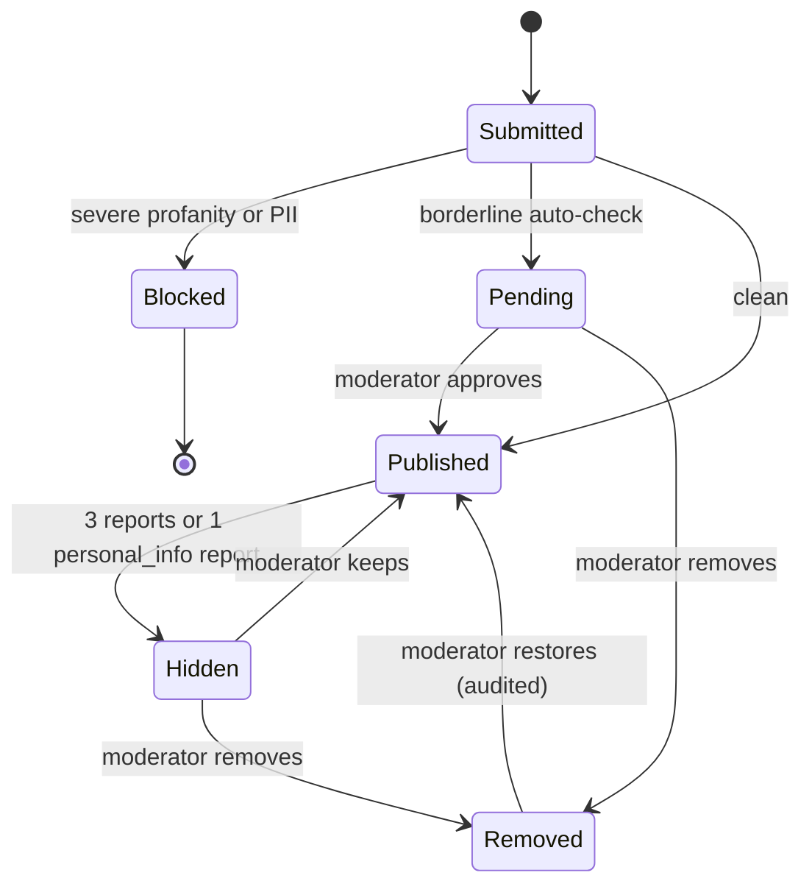
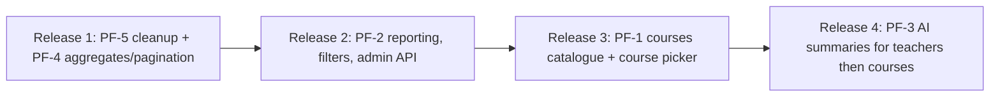

# PRD-02 — Backend Missing Product Features

| Field | Value |
| :--- | :--- |
| **Product** | SirKaisaHai — Anonymous Teacher Reviews (Superior University, Phase 1 → 2) |
| **Component** | `backend/` (FastAPI + SQLAlchemy) and `sirkaisahai_first/` integration |
| **Document type** | Product Requirements Document (Features) |
| **Status** | Draft — ready for scoping |
| **Priority** | P1 (post-launch hardening) — PF-4 is P0 if > 200 teachers at launch |
| **Created** | 2026-11-21 |
| **Depends on** | `PRD-01-Backend-Must-Fix-Blockers.md` (auth dependency, Alembic, HMAC identity) |

---

## 1. Summary

The UI already promises several capabilities the backend does not deliver. The frontend currently hides these gaps with mock data and placeholder screens:

- `/courses` shows *"This section is not available right now"*; `api.getCourseById` reads `mockCourses`; `getReviewsForCourse(courseId)` ignores `courseId` and returns **all** reviews.
- The footer promises **"Moderated"**, but there is no way to report or remove a review, and the profanity filter is a 7-word English substring list.
- Professors show an `aiSummary`, but it is a hardcoded sentence (`"<name> is a faculty member in the <dept> department."`); [ai_summary.py](../backend/app/services/ai_summary.py) is a stub never called.
- Listing/searching professors runs one extra SQL query per professor and returns everything without pagination.
- `api.getUniversity()` returns mock data; several dependencies and settings are unused.

| ID | Feature | User value | Effort |
| :--- | :--- | :--- | :--- |
| **PF-1** | Courses catalogue & course-linked reviews | Students compare *who teaches a course best*, not just teachers | L |
| **PF-2** | Reporting, moderation & admin API | Keeps the platform safe, fair and legally defensible | L |
| **PF-3** | Real AI review summaries | Read a fair 3-line digest instead of 40 reviews | M |
| **PF-4** | Performance, pagination & sorting | Fast search on campus mobile data | M |
| **PF-5** | University endpoint, schema alignment & cleanup | Removes mocks; smaller, clearer codebase | S |

*Effort: S ≤ 1 day, M 2–4 days, L 1–2 weeks (one developer).*

---

## 2. Goals & Non-Goals

### Goals
- Remove **all** remaining mock data paths from the production frontend.
- Deliver the "Moderated" promise with a credible, auditable moderation workflow.
- Keep p95 API latency < 300 ms for list/search endpoints at 1,000 teachers / 20,000 reviews.
- Preserve the anonymity invariant from PRD-01 §3 in every new table.

### Non-Goals
- Multi-university tenancy (Phase 3).
- Student accounts with profiles, follows, or notifications.
- A full admin web UI (this PRD specifies the **API**; a minimal admin page is optional — see PF-2 §Frontend).
- Native mobile apps.

---

## 3. Personas

| Persona | Description | Primary needs |
| :--- | :--- | :--- |
| **Ayesha — Prospective registrant** | BSSE 4th semester, choosing electives on her phone between classes | Find who teaches *Data Structures* best; quick digest; fast pages |
| **Hamza — Contributor** | Verified student who writes reviews | Add a missing teacher/course; report an unfair review |
| **Moderator** | Trusted student/maintainer team member | Triage reports quickly; remove doxxing/abuse; merge duplicate teachers |
| **Maintainer** | Developer operating the platform | Low cost, observable, safe defaults |

---

## 4. Feature Requirements

### PF-1 — Courses Catalogue & Course-Linked Reviews

#### Problem
Reviews store free-text `course_code` / `course_title` (defaulting to `"CS-101"` / `"Course"`). There is no `courses` table, so the backend cannot answer "which teachers teach *CS-201*?" or "what do students say about this course?". The frontend `Course` type (`id, departmentId, departmentName, code, title, description, creditHours, avgRating, totalReviews, aiSummary`) has no backend counterpart, and `Review.offeringId` / `Review.courseId` are never returned.

#### User Stories
- **US-1.1** As Ayesha, I can browse courses by department and search by code or title.
- **US-1.2** As Ayesha, on a course page I see every teacher who has taught it, each with their rating **for that course**.
- **US-1.3** As Hamza, when writing a review I pick a course from a list (or the teacher's known courses) instead of typing free text.
- **US-1.4** As Hamza, if a course is missing I can suggest it; it becomes visible after moderator approval.

#### Functional Requirements
| ID | Requirement |
| :--- | :--- |
| PF-1.1 | New `courses` table, seeded with core Computing courses per department (code, title, credit hours, description). |
| PF-1.2 | New `course_offerings` table linking `course_id` ↔ `professor_id` (optionally `semester`). Offerings are created automatically when a verified review is submitted for a (course, professor) pair. |
| PF-1.3 | `reviews.course_id` (nullable FK). New reviews **must** reference a course; legacy reviews keep `course_code`/`course_title` and are backfilled where the code matches a seeded course. |
| PF-1.4 | Course aggregates (avg teaching/grading/workload, overall, review count) are computed from reviews with that `course_id`. |
| PF-1.5 | Course-per-teacher aggregates are available on the course detail endpoint. |
| PF-1.6 | Verified students can submit a **course suggestion** (`status = pending`); pending courses are hidden from public lists and selectable only by their suggester until approved (moderators approve via PF-2). |
| PF-1.7 | Course codes are unique per department after normalization (`cs 201` → `CS-201`). |

#### Data Model
```text
courses
  id             UUID (PK)
  department_id  FK -> departments.id   INDEX
  code           VARCHAR(20)            -- normalized, e.g. "CS-201"
  title          VARCHAR(200)
  description    TEXT NULL
  credit_hours   SMALLINT DEFAULT 3
  status         VARCHAR(16) DEFAULT 'active'   -- 'active' | 'pending' | 'archived'
  created_at     TIMESTAMP
  UNIQUE (department_id, code)

course_offerings
  id             UUID (PK)
  course_id      FK -> courses.id      INDEX
  professor_id   FK -> professors.id   INDEX
  first_seen_at  DATE
  UNIQUE (course_id, professor_id)

reviews  (+ column)
  course_id      FK -> courses.id NULL INDEX
```

> [!NOTE]
> `courses.status = 'pending'` rows must **not** store who suggested them in a way that links to reviews. Store the suggester only in a separate `content_submissions` audit table keyed by `user_id` (same pattern as `teacher_creation_logs`), never on `reviews`.

#### API Specification
| Method | Path | Auth | Description |
| :--- | :--- | :--- | :--- |
| `GET` | `/api/courses?departmentId=&q=&limit=&offset=&sort=` | Public | List active courses with aggregates |
| `GET` | `/api/courses/{course_id}` | Public | Course detail + aggregates + teachers who taught it |
| `GET` | `/api/courses/{course_id}/professors` | Public | Per-teacher stats for this course |
| `GET` | `/api/professors/{prof_id}/courses` | Public | Courses a teacher has reviews for |
| `GET` | `/api/reviews?courseId=&professorId=` | Public | Filter by course and/or teacher (both optional, combinable) |
| `POST` | `/api/courses` | Verified | Suggest a course → `201 {status: "pending"}` |

**`GET /api/courses/{id}` response**
```json
{
  "id": "c-ds",
  "departmentId": "dept-cs",
  "departmentName": "Computer Science",
  "code": "CS-201",
  "title": "Data Structures",
  "description": "Arrays, linked lists, trees, graphs, hashing.",
  "creditHours": 4,
  "avgRating": 4.1,
  "totalReviews": 37,
  "aiSummary": null,
  "professors": [
    { "id": "p1", "name": "Dr. Ali Khan", "overallRating": 4.5, "reviewCount": 21 },
    { "id": "p2", "name": "Ms. Sara Ahmed", "overallRating": 3.6, "reviewCount": 16 }
  ]
}
```

**`ReviewCreate` change**: add `courseId: str` (required for new clients). Accept legacy `courseCode`/`courseTitle` for one release; if `courseId` is missing, resolve by normalized code within the professor's department or reject with `422`.

#### Frontend Impact
- [api/index.ts](../sirkaisahai_first/src/api/index.ts): implement `getCourses`, `getCourseById`, `getReviewsForCourse(courseId)` (pass `courseId`), and rebuild `getOfferings` from `/api/professors/{id}/courses`.
- Replace the "unavailable" [BrowseCoursesPage.vue](../sirkaisahai_first/src/pages/BrowseCoursesPage.vue) with a real catalogue once PF-1 ships; remove `hideFooter` meta for `/courses` in [router/index.ts](../sirkaisahai_first/src/router/index.ts).
- [SubmitReviewPage.vue](../sirkaisahai_first/src/pages/SubmitReviewPage.vue): course picker (searchable select) + "Suggest a course" link.
- Delete `mockCourses` / `mockOfferings` usage from production code paths.

#### Acceptance Criteria
- [ ] `GET /api/courses?departmentId=dept-se` returns only SE courses, each with correct aggregates.
- [ ] Submitting a review with `courseId` creates/updates the matching `course_offerings` row.
- [ ] `GET /api/reviews?courseId=X` never returns reviews of other courses.
- [ ] Course detail lists per-teacher ratings computed only from that course's reviews.
- [ ] A suggested course is invisible in public lists until approved.

#### Success Metrics
- ≥ 80% of new reviews reference a seeded (not suggested) course within 30 days.
- Course pages account for ≥ 25% of page views during the registration window.

---

### PF-2 — Reporting, Moderation & Admin API

#### Problem
Anonymous reviews attract abuse, doxxing (sharing a student's or teacher's phone number / personal details), and defamatory claims. Today:
- Students cannot report a review.
- Maintainers can only delete rows directly in the database.
- [profanity.py](../backend/app/services/profanity.py) uses substring matching on 7 English words — it **blocks legitimate reviews** (e.g. *"He is very strict about cheating"* contains `cheat`) while missing Roman Urdu abuse, obfuscations (`1d10t`), and personal data.
- Duplicate teachers (e.g. "Sir Ali" vs "Ali Raza") cannot be merged; reviews would be split.
- The only admin control is `POST /api/auth/reset-test-users` behind a static header secret.

#### User Stories
- **US-2.1** As Hamza, I can report a review with a reason; I cannot report the same review twice.
- **US-2.2** As a moderator, I see a queue of reported/auto-flagged reviews sorted by severity and report count, and can **keep**, **hide**, or **remove** each one.
- **US-2.3** As a moderator, I can edit a teacher's name/title/department, merge duplicates (moving all reviews), and approve suggested courses/teachers.
- **US-2.4** As a maintainer, every moderation action is logged with who did it and why.
- **US-2.5** As Ayesha, I never see reviews that contain phone numbers, emails, or roll numbers.

#### Functional Requirements

**A. Review lifecycle**
| ID | Requirement |
| :--- | :--- |
| PF-2.1 | Add `reviews.status`: `published` (default) · `pending` (held by auto-filter) · `hidden` (temporarily removed pending review) · `removed` (permanent). Public endpoints return only `published`. |
| PF-2.2 | Aggregates (teacher/course ratings) include **only** `published` reviews. |
| PF-2.3 | When a review is `removed`, the author's `teacher_submission_logs` slot is **kept** (prevents abuse via delete-and-repost). |

**B. Student reporting**
| ID | Requirement |
| :--- | :--- |
| PF-2.4 | `POST /api/reviews/{id}/report` (verified only) with `reason ∈ {abuse, personal_info, false_info, spam, off_topic, other}` and optional `details` (≤ 300 chars). |
| PF-2.5 | One report per student per review, enforced with an unlinkable key: `reporter_key = HMAC(REPORT_SECRET, user_id + ":" + review_id)`. |
| PF-2.6 | Auto-hide: a review reaching **3 distinct reports**, or **1 `personal_info` report**, moves to `hidden` until a moderator decides. Thresholds are configurable. |
| PF-2.7 | Report rate limit: 20 / day per student. |

**C. Automated content checks (on submit)**
| ID | Requirement |
| :--- | :--- |
| PF-2.8 | Replace substring matching with **word-boundary** matching over a normalized string (lowercase, leetspeak map `0→o 1→i 3→e 4→a 5→s @→a`, repeated chars collapsed). |
| PF-2.9 | Maintain blocklists in versioned data files: `english.txt`, `roman_urdu.txt`, `urdu.txt`, plus an `allowlist.txt` (e.g. `cheating`, `scam` in the sense of "exam scam") to cut false positives. |
| PF-2.10 | **PII detector** blocks or holds reviews containing: phone numbers (`03xx-xxxxxxx`, `+92…`), emails, Superior roll numbers (`bsse-f22-045` patterns), CNIC (`xxxxx-xxxxxxx-x`), URLs to social profiles. |
| PF-2.11 | Severity outcome: `block` (422 with friendly reason, nothing stored), `hold` (stored as `pending`, needs moderator), `allow`. Severe profanity/PII → `block`; borderline → `hold`. |
| PF-2.12 | The API error message tells the student **what category** to fix (e.g. "Please remove phone numbers or personal details") without echoing the matched word list. |

**D. Admin & moderation API**
| ID | Requirement |
| :--- | :--- |
| PF-2.13 | Admin endpoints live under `/api/admin/*`, are excluded from the public OpenAPI schema, and require a **moderator credential** (see Auth below). |
| PF-2.14 | Every admin mutation writes a `moderation_actions` row (actor, action, target, reason, before/after snapshot of non-identifying fields). |
| PF-2.15 | Teacher merge moves all `reviews`, `course_offerings`, and `teacher_submission_logs` from source to target in one transaction; where a student has logs for both, keep one log and mark the newer review `hidden` for moderator decision (prevents double-voting a teacher). |
| PF-2.16 | Replace `POST /api/auth/reset-test-users` with `POST /api/admin/maintenance/reset-test-data`, disabled entirely in production. |

#### Admin Authentication (Phase 1 → Phase 2)
| Phase | Mechanism | Notes |
| :--- | :--- | :--- |
| **Phase 1** | Per-moderator API keys: `moderators` table storing `name`, `key_hash` (SHA-256 of a random 32-byte token), `role ∈ {moderator, admin}`, `active`. Sent as `Authorization: Bearer <key>`. | Simple, revocable per person, auditable. No link to student identities. |
| **Phase 2** | Moderator login via OTP to an allowlisted staff email + separate `skh_admin` cookie with short TTL (8h). | Optional when the team grows. |

#### Data Model
```text
reviews (+ columns)
  status             VARCHAR(16) DEFAULT 'published' INDEX
  moderation_reason  VARCHAR(64) NULL
  moderated_at       TIMESTAMP NULL

review_reports
  id            UUID (PK)
  review_id     FK -> reviews.id INDEX
  reporter_key  VARCHAR(64)                -- HMAC(REPORT_SECRET, user_id:review_id)
  reason        VARCHAR(24)
  details       VARCHAR(300) NULL
  created_at    TIMESTAMP
  resolved_at   TIMESTAMP NULL
  UNIQUE (review_id, reporter_key)

moderators
  id          UUID (PK)
  name        VARCHAR(100)
  key_hash    VARCHAR(64) UNIQUE
  role        VARCHAR(16)                  -- 'moderator' | 'admin'
  active      BOOLEAN DEFAULT TRUE
  created_at  TIMESTAMP

moderation_actions
  id            UUID (PK)
  moderator_id  FK -> moderators.id
  action        VARCHAR(32)                -- 'review.hide', 'review.remove', 'review.restore',
                                           -- 'professor.update', 'professor.merge', 'course.approve', ...
  target_type   VARCHAR(16)
  target_id     VARCHAR(64)
  reason        VARCHAR(300)
  snapshot      JSON
  created_at    TIMESTAMP
```

#### API Specification
| Method | Path | Role | Description |
| :--- | :--- | :--- | :--- |
| `POST` | `/api/reviews/{id}/report` | Verified student | File a report → `201` / `409` if already reported |
| `GET` | `/api/admin/queue?status=hidden,pending&limit=&offset=` | Moderator | Reviews needing action, with report counts by reason |
| `PATCH` | `/api/admin/reviews/{id}` | Moderator | `{ "status": "published" \| "hidden" \| "removed", "reason": "..." }` |
| `GET` | `/api/admin/reviews/{id}/reports` | Moderator | Reasons and details (no reporter identity) |
| `PATCH` | `/api/admin/professors/{id}` | Moderator | Edit name, title, department, tags |
| `POST` | `/api/admin/professors/{id}/merge` | Admin | `{ "targetId": "..." }` — merge source into target |
| `PATCH` | `/api/admin/courses/{id}` | Moderator | Approve/edit/archive suggested courses |
| `GET` | `/api/admin/actions?limit=&offset=` | Admin | Audit log |
| `GET` | `/api/admin/stats` | Moderator | Counts: pending, hidden, reports last 7 days, reviews/day |

#### Moderation Flow


#### Frontend Impact
- Review card: "Report" menu item with reason picker (verified users only).
- Submit form: inline guidance + friendly error for PII/profanity categories.
- *(Optional)* Minimal `/admin` route behind the moderator key (queue list + Keep / Hide / Remove buttons). Can be deferred by using the API through a script or Swagger in a protected environment.

#### Acceptance Criteria
- [ ] *"He is strict about cheating"* is accepted; *"he is an 1d10t"* is blocked.
- [ ] A review containing `0300-1234567` is blocked with a "remove personal details" message.
- [ ] Third distinct report hides a review; it disappears from public endpoints and aggregates immediately.
- [ ] The same student reporting twice gets `409`.
- [ ] Merging two teachers moves all reviews; the target's aggregates reflect the combined set.
- [ ] Every admin action appears in `/api/admin/actions`.
- [ ] `review_reports` has no `user_id` column; `moderation_actions` never stores student identifiers.

#### Success Metrics
- Median time from auto-hide to moderator decision < 24 h.
- False-positive block rate < 2% (measured from student appeals / support messages).
- Zero published reviews containing PII in monthly audit samples.

---

### PF-3 — Real AI Review Summaries

#### Problem
`Professor.ai_summary` is filled with a placeholder at creation time and never updated. [ai_summary.py](../backend/app/services/ai_summary.py) returns the same generic praise for any teacher ("recognized for structured lectures…"), which is **misleading** — it can show positive text for a poorly rated teacher.

#### User Stories
- **US-3.1** As Ayesha, I see a short, balanced summary (strengths, concerns, workload, grading) for teachers with enough reviews.
- **US-3.2** As Ayesha, I understand the summary is AI-generated and how many reviews it's based on.
- **US-3.3** As a teacher's student, I trust that the summary doesn't quote or expose any individual reviewer.

#### Functional Requirements
| ID | Requirement |
| :--- | :--- |
| PF-3.1 | Summaries are generated only when a teacher has **≥ 3 published reviews** (configurable `AI_SUMMARY_MIN_REVIEWS`). Below that, `aiSummary` is `null` and the UI shows "Not enough reviews for a summary yet". |
| PF-3.2 | Remove the placeholder `ai_summary` written in `create_professor`. |
| PF-3.3 | Regeneration is triggered asynchronously after a review is published/hidden/removed, **debounced**: regenerate when ≥ 3 new reviews since last summary **or** ≥ 24 h since last summary with any change. |
| PF-3.4 | Generation runs outside the request path (FastAPI `BackgroundTasks` in Phase 1; a queue/cron worker later). Review submission latency must not increase. |
| PF-3.5 | Output format: 2–4 sentences, ≤ 450 characters, plain text, neutral tone, covers teaching clarity, grading, workload, and the most common concern. |
| PF-3.6 | Guardrails: no direct quotes, no student names/roll numbers, no claims not supported by ≥ 2 reviews, no profanity; output passes the PF-2 content filter before saving. |
| PF-3.7 | Store `ai_summary_updated_at` and `ai_summary_review_count`; API exposes both so the UI can show "Based on 14 reviews · updated 2 days ago". |
| PF-3.8 | Provider failures (timeout, quota, missing key) leave the previous summary unchanged and are logged; no user-facing errors. |
| PF-3.9 | Same pipeline supports **course summaries** once PF-1 ships (`courses.ai_summary`). |
| PF-3.10 | Cost control: input capped to the most recent 60 published reviews (each truncated to 500 chars); daily generation cap `AI_SUMMARY_DAILY_LIMIT` (default 200). |

#### Technical Design
- Provider: Google Gemini API via `google-genai` SDK; model configurable via `AI_SUMMARY_MODEL` (use a fast, low-cost Flash-class model).
- Input passed to the model: per review only `{teaching, grading, workload, semester, comment}` — **no** ids, timestamps, or grade received (grade + semester could narrow down the author in small classes).
- Prompt outline:
  ```text
  System: You summarize anonymous student feedback about a university teacher.
  Rules: 2–4 sentences, under 450 characters. Neutral and fair. Mention teaching clarity,
  grading fairness, workload, and the most common concern. Do not quote reviews.
  Do not include names, numbers identifying people, or claims made by only one review.
  User: Average ratings: teaching 4.2, grading 3.1, workload 3.8 (n=14).
        Reviews: [ ... ]
  ```
- New columns:
  ```text
  professors.ai_summary_updated_at   TIMESTAMP NULL
  professors.ai_summary_review_count INTEGER   NULL
  professors.ai_summary_status       VARCHAR(16) DEFAULT 'none'  -- none|fresh|stale|failed
  ```
- Admin endpoint (PF-2 role): `POST /api/admin/professors/{id}/regenerate-summary`, `PATCH` to clear a bad summary.

#### API Changes
`ProfessorOut` adds:
```json
{
  "aiSummary": "Students find Dr. Khan's lectures clear and well structured...",
  "aiSummaryUpdatedAt": "2026-11-20T10:12:00Z",
  "aiSummaryReviewCount": 14
}
```

#### New Environment Variables
| Variable | Purpose | Default |
| :--- | :--- | :--- |
| `GEMINI_API_KEY` | Provider key (feature disabled if empty) | — |
| `AI_SUMMARY_MODEL` | Model id | Flash-class model |
| `AI_SUMMARY_MIN_REVIEWS` | Minimum reviews before summarizing | `3` |
| `AI_SUMMARY_DAILY_LIMIT` | Max generations per day | `200` |

#### Acceptance Criteria
- [ ] Teachers with < 3 reviews return `aiSummary: null`.
- [ ] A teacher averaging 2.0/5 never receives a uniformly positive summary (manual eval on 20 fixtures).
- [ ] Review submission p95 latency is unchanged (± 20 ms) with summaries enabled.
- [ ] With `GEMINI_API_KEY` unset, the app runs normally and summaries stay `null`.
- [ ] No summary contains a verbatim span ≥ 8 words from any single review (automated check).

---

### PF-4 — Performance, Pagination & Sorting

#### Problem
- [professors.py](../backend/app/routers/professors.py) `build_professor_out()` runs `SELECT * FROM reviews WHERE professor_id = ?` **for each professor** (N+1). `GET /api/professors` and `/api/professors/search/all` therefore issue 1 + N queries and load every review row into Python.
- `GET /api/reviews` returns **every review** in the database with no limit (the home page calls it).
- No server-side sorting; teachers with zero reviews show `overallRating: 5.0`, ranking them above genuinely good teachers.
- `create_professor` loads all professors to check duplicates (addressed by PRD-01 MF-7).

#### Functional Requirements
| ID | Requirement |
| :--- | :--- |
| PF-4.1 | Professor list/search/detail aggregates are computed with a **single** SQL query using `LEFT JOIN … GROUP BY` (or maintained aggregate columns, see design). |
| PF-4.2 | All list endpoints accept `limit` (default 20, max 100) and `offset` (default 0). |
| PF-4.3 | Total count is returned in an `X-Total-Count` response header (exposed via CORS `expose_headers`), keeping the JSON body a plain array for backward compatibility. |
| PF-4.4 | Sorting: `sort ∈ {relevance, rating, reviews, name, recent}` with `order ∈ {asc, desc}`. |
| PF-4.5 | Teachers with 0 reviews return `overallRating: null` (and `avgTeaching/avgGrading/avgWorkload: null`), not `5.0/3.0`. `rating` sort ranks by a **Bayesian average** so a single 5★ review doesn't outrank 40 reviews at 4.6★. |
| PF-4.6 | `GET /api/reviews` defaults to the 20 most recent published reviews; `GET /api/reviews?professorId=` paginates too. |
| PF-4.7 | Search matches name, title, and department name, case-insensitively, with accent/honorific-insensitive matching (search "ali" finds "Dr. Ali Khan"). PostgreSQL uses `pg_trgm` index for `ILIKE`; SQLite falls back to `LIKE`. |
| PF-4.8 | Public GET responses send `Cache-Control: public, max-age=30, stale-while-revalidate=120`. |

#### Technical Design
**Option A (recommended for Phase 1): aggregate query**
```sql
SELECT p.*, d.name AS department_name,
       COUNT(r.id)                     AS total_reviews,
       ROUND(AVG(r.rating_teaching),1) AS avg_teaching,
       ROUND(AVG(r.rating_grading),1)  AS avg_grading,
       ROUND(AVG(r.rating_workload),1) AS avg_workload,
       ROUND(AVG(r.overall_score),1)   AS overall_rating
FROM professors p
JOIN departments d ON d.id = p.department_id
LEFT JOIN reviews r ON r.professor_id = p.id AND r.status = 'published'
WHERE (:dept IS NULL OR p.department_id = :dept)
GROUP BY p.id, d.name
ORDER BY ...
LIMIT :limit OFFSET :offset;
```

**Option B (when > 50k reviews): denormalized aggregates**
- Add `professors.review_count`, `sum_teaching`, `sum_grading`, `sum_workload`, `sum_overall`, updated transactionally on review publish/hide/remove (and by merge). Reads become O(1) per row.

**Bayesian rating** (for sorting only):

$$\text{score} = \frac{C \cdot m + \sum \text{ratings}}{C + n}$$

where $m$ is the global mean rating, $n$ the teacher's review count, and $C = 5$ (configurable).

#### Performance Targets
| Endpoint | Dataset | p95 target |
| :--- | :--- | :--- |
| `GET /api/professors/search/all?q=ali` | 1,000 teachers / 20,000 reviews | < 150 ms |
| `GET /api/professors/{id}` | same | < 80 ms |
| `GET /api/reviews?professorId=…&limit=20` | same | < 80 ms |
| `GET /api/reviews` (home) | same | < 80 ms |

#### Frontend Impact
- Search page: "Load more" / infinite scroll using `offset` and `X-Total-Count`.
- Home page: request `?limit=6` for recent reviews.
- Rating badge: render "No ratings yet" when `overallRating` is `null` (type change: `number | null`).

#### Acceptance Criteria
- [ ] Listing 100 professors issues ≤ 2 SQL queries (verified via SQLAlchemy echo / query counter in tests).
- [ ] Seeded load test (1k teachers / 20k reviews) meets the p95 targets on the production DB tier.
- [ ] A teacher with one 5★ review ranks below a teacher with 40 reviews averaging 4.6★ under `sort=rating`.
- [ ] Existing frontend continues to work without changes (arrays still returned) before the UI adopts pagination.

---

### PF-5 — University Endpoint, Schema Alignment & Cleanup

#### Problem
- `api.getUniversity()` returns `mockUniversity`; there is no endpoint even though the `universities` table exists.
- Frontend `Review` type includes `offeringId`, `courseId`, `tags` that the backend never returns; `ReviewOut` uses `createdAt` with full microsecond precision.
- Dead code / dependencies: `python-jose`, `passlib` (unused — sessions are opaque DB tokens), `SECRET_KEY`, `ALGORITHM`, `ACCESS_TOKEN_EXPIRE_MINUTES` settings; `send_update_email` / `send_news_email` with no callers; `clean_db.py` with a hardcoded Windows path; `authorization: Header` parameters in routers that are never read.
- Inconsistent naming: "professors" in API vs "teachers" in UI copy; error messages hardcode "15 minutes" for all rate limits.

#### Functional Requirements
| ID | Requirement |
| :--- | :--- |
| PF-5.1 | `GET /api/university` returns the active university (`id, name, shortName, domain, logoUrl, departmentsCount, professorsCount, reviewsCount`). Cached 5 min. |
| PF-5.2 | `ReviewOut` aligns with the frontend type: add `courseId` (PF-1), drop or populate `offeringId`, return `createdAt` as ISO-8601 truncated to **minutes** (anonymity — PRD-01 MF-7 note). |
| PF-5.3 | Remove `python-jose`, `passlib` from [requirements.txt](../backend/requirements.txt) and the unused JWT settings from [config.py](../backend/app/config.py). |
| PF-5.4 | Remove unused `authorization: Optional[str] = Header(...)` parameters from `submit_review` and `create_professor`. |
| PF-5.5 | Move unused email templates to a `templates/` module behind a feature flag, or delete them; keep only `send_otp_email` wired. |
| PF-5.6 | Delete `clean_db.py` (superseded by PRD-01 MF-6 reset command). |
| PF-5.7 | Pin dependency versions (upper bounds) in `requirements.txt` and add `requirements-dev.txt` (`pytest`, `httpx`, `ruff`). |
| PF-5.8 | Standardize error shape across the API: `{ "detail": "<human message>", "code": "<machine_code>" }` (e.g. `review_duplicate`, `auth_required`, `content_pii`). |

#### Acceptance Criteria
- [ ] Frontend `getUniversity()` reads from `/api/university`; `mockUniversity` is no longer imported in production code.
- [ ] `pip install -r requirements.txt` no longer installs `python-jose` or `passlib`; app boots and all tests pass.
- [ ] Every non-2xx response includes `detail` and `code`.
- [ ] `grep -r "mockData" sirkaisahai_first/src` returns only test/dev-only usages.

---

## 5. Cross-Cutting Requirements

| Area | Requirement |
| :--- | :--- |
| **Anonymity** | New linkage tables (`review_reports`, `content_submissions`) use per-target HMAC keys or keep `user_id` only in tables that never contain `review_id`. Reviewed in a privacy checklist before merge. |
| **Migrations** | Every schema change ships as an Alembic migration (PRD-01 MF-6) with a tested downgrade. |
| **Testing** | Each feature adds `pytest` API tests covering its acceptance criteria; CI runs on every PR. |
| **Observability** | Structured logs (JSON) for moderation actions, AI generation outcomes, and rate-limit hits — never log review text with identifiers or emails. |
| **API docs** | Public endpoints documented in OpenAPI (dev only); `/api/admin/*` excluded via `include_in_schema=False`. |
| **Backward compatibility** | Existing frontend keeps working at each release; breaking changes ship behind new params/fields first. |

---

## 6. Release Plan



| Release | Contents | Rationale |
| :--- | :--- | :--- |
| **R1** | PF-5, PF-4 | Low risk; unblocks clean contracts and fast lists before traffic grows |
| **R2** | PF-2 | Moderation must exist before marketing pushes and before AI summarizes potentially abusive text |
| **R3** | PF-1 | Largest data-model change; benefits from moderation (course suggestions) |
| **R4** | PF-3 | Needs moderation (clean inputs) and courses (course summaries) |

---

## 7. Dependencies

| Dependency | Needed by | Source |
| :--- | :--- | :--- |
| `get_current_user` auth dependency | PF-1.6, PF-2.4 | PRD-01 MF-1 |
| Alembic migrations | All | PRD-01 MF-6 |
| HMAC secrets infrastructure | PF-2.5 | PRD-01 MF-3 |
| Persistent rate-limit storage | PF-2.7, PF-1.6 | PRD-01 MF-4 |
| Gemini API key & billing | PF-3 | Maintainer account |
| Seed course list per department | PF-1.1 | Superior University scheme of studies (manual curation) |

---

## 8. Open Questions

1. **Who are the moderators** for Phase 1 (core team only, or trusted student volunteers)? Affects role design and response-time targets.
2. **Course seed source** — will the team curate the official scheme of studies for all 8 departments, or start with CS/SE only?
3. **Appeals** — should a student whose review was removed be told why? (Requires a way to notify an anonymous author; likely "no" in Phase 1.)
4. **Teacher right-of-reply** — out of scope now; revisit for legal/defamation policy.
5. **AI summary language** — English only, or also Roman Urdu output?
6. **Should zero-review teachers be shown in search at all**, or only when searched by name?

---

## 9. Definition of Done

- [ ] No production frontend code path reads from `mockData.ts`.
- [ ] `/courses` shows the real catalogue; the "unavailable" screen is removed.
- [ ] Reports, auto-hide, and the admin queue work end-to-end on staging.
- [ ] AI summaries appear for teachers with ≥ 3 reviews and pass the evaluation set.
- [ ] Load test meets PF-4 targets.
- [ ] Privacy checklist signed off for every new table.
- [ ] `README.md` roadmap updated to reflect shipped features.
