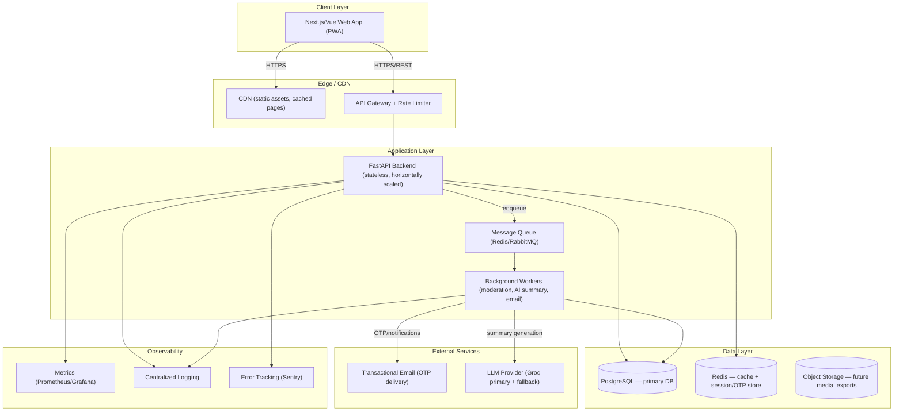
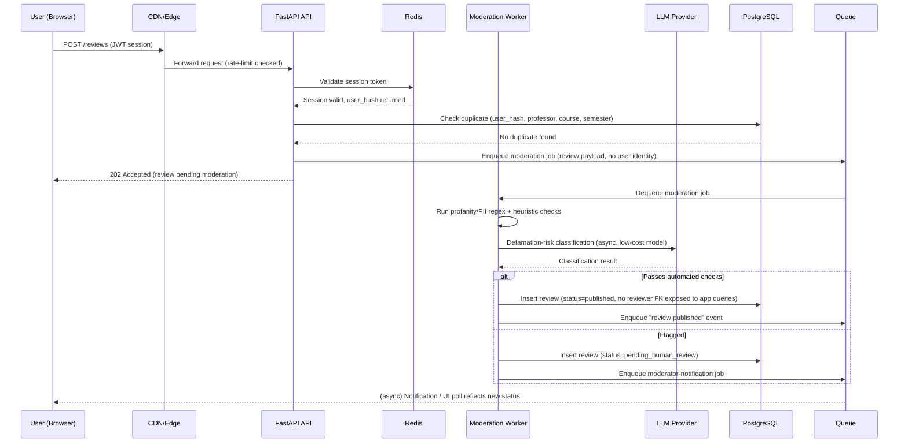
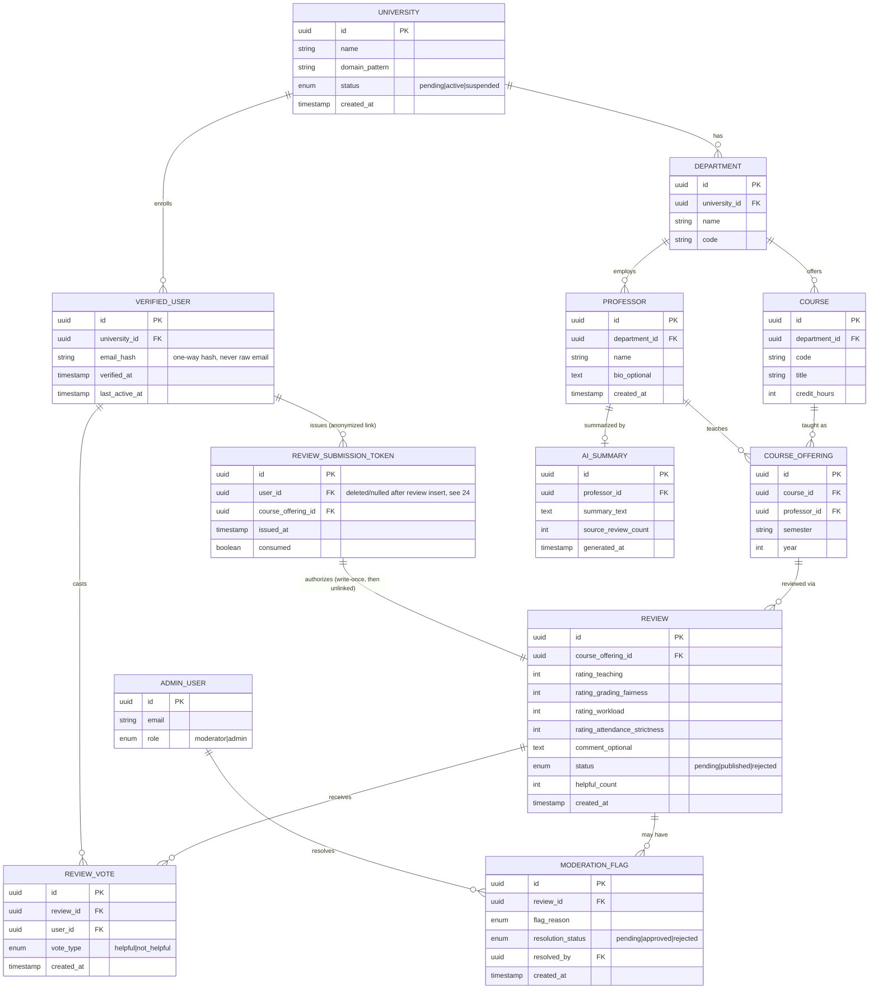
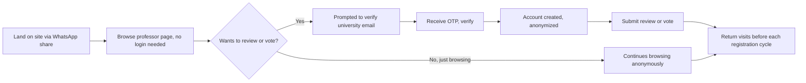
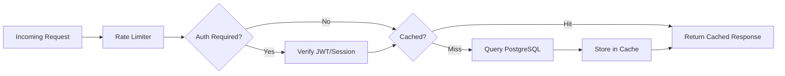
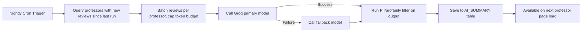
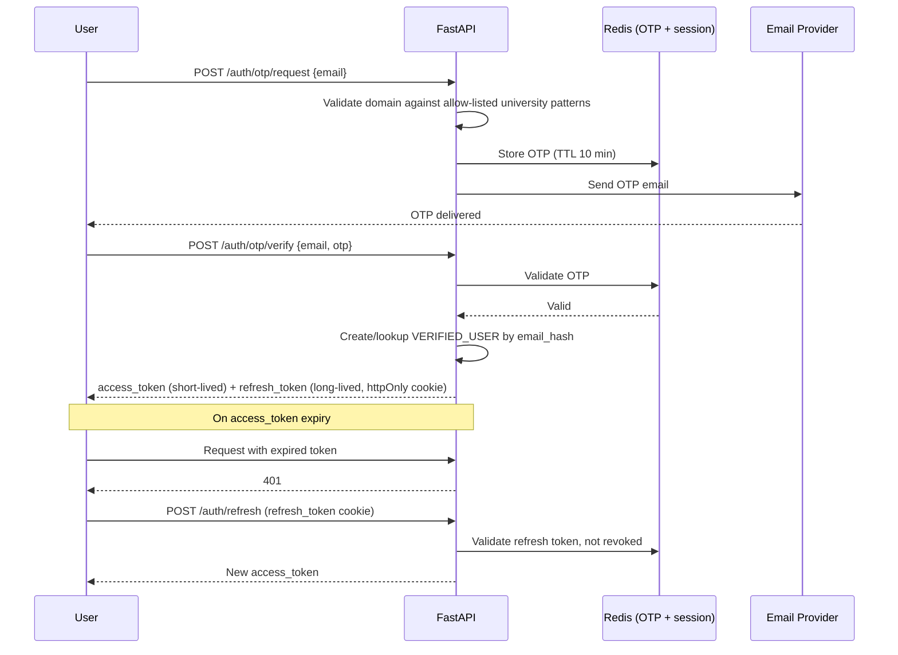
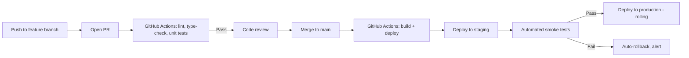

# SirKaisaHai — Product Requirements Document
### Anonymous Course & Professor Review Platform for Pakistani Universities

**Version:** 1.0
**Status:** Draft for engineering handoff
**Assumption noted:** Product name used throughout is "SirKaisaHai" (working name, per earlier naming discussion — Urdu-English hybrid meaning "how's the teacher"). Rename is a config change (see §27 AI Development Rules — no hardcoded branding), not a re-architecture.

---

## 1. Executive Summary

SirKaisaHai is an anonymous, student-only platform where university students in Pakistan rate and review professors and courses. Students currently rely on scattered WhatsApp groups and word-of-mouth from seniors to decide which sections or electives to pick — information that is unsearchable, outdated within a semester, and inaccessible to new students. SirKaisaHai centralizes this into a searchable, structured, always-current database, gated by university-email verification so every review comes from a real student while remaining fully anonymous in what's displayed publicly.

The product launches single-campus (Superior University, Lahore) to seed a dense, trustworthy dataset, then expands campus-by-campus across Pakistan using organic WhatsApp/social spread rather than paid acquisition — the anonymity of the reviews (and of the builder) is a growth mechanic, not just a privacy feature.

**Roadmap shape:**
- **MVP (Superior-only):** verified signup, browse professors/courses, submit/read anonymous reviews, basic search.
- **Beta (multi-campus):** self-serve university onboarding, moderation tooling, AI-generated review summaries, reputation/quality signals on reviews.
- **Production (national scale):** full search/filtering, course-planning tools, mobile-optimized PWA, notification system, admin dashboards per university.
- **Enterprise (institutional):** opt-in aggregate analytics dashboards licensed to universities/HEC (anonymized, consent-based), SSO integration, compliance tooling.

---

## 2. Product Vision

In 3–5 years, SirKaisaHai is the default first stop for any student in Pakistan choosing a course, section, or elective — the way RateMyProfessors is a reflex in the US, but built for the Pakistani academic structure (majors, sections, credit-hour systems, HEC-regulated universities) and for how Pakistani students actually communicate (WhatsApp-first, Urdu-English code-switching, mobile-first, low-bandwidth-tolerant).

Long-term, the platform becomes a two-sided trust layer: students get honest, current insight into teaching quality; universities (opt-in, anonymized) get a signal they cannot get from official course evaluations, which are typically low-response-rate and administratively filtered. The product never sells identifiable student data and never de-anonymizes reviewers — that guarantee is the core moat, because it is what makes reviews honest in the first place.

---

## 3. Problem Statement

- **Fragmented information:** Course/professor quality information exists only in ephemeral WhatsApp groups, per-section, per-semester. It is not searchable, not persistent, and inaccessible to students outside that specific group (e.g., freshmen, transfer students).
- **No safe channel for honest feedback:** Official university course evaluations are not anonymous in practice (small class sizes make handwriting/response patterns identifiable, and evaluations happen before grades are released, discouraging candor), and results are rarely shared back to students.
- **Information asymmetry hurts new/transfer students most:** Senior students accumulate this knowledge informally; freshmen, transfer students, and students without strong social networks in their department make blind choices every registration cycle.
- **Existing global solutions don't fit:** RateMyProfessors and similar platforms have negligible coverage of Pakistani institutions, don't reflect local grading culture (relative grading, attendance policies, "GPA killer" courses), and aren't built for the WhatsApp-centric way Pakistani students actually share information.

---

## 4. Goals

**Business goals**
- Reach product-market fit at one campus (validated by >30% of an incoming batch's students engaging within one semester) before expanding.
- Achieve organic, zero-paid-CAC growth to 5+ universities within 12 months of MVP launch.
- Build toward an optional B2B2C revenue line (anonymized institutional analytics) without compromising the anonymity guarantee to students.

**Product goals**
- Make "check SirKaisaHai before registering" a habitual pre-registration action for students.
- Maintain review density high enough that every actively-taught course/professor combination has at least 3 reviews within two semesters of campus launch.
- Keep the anonymous-submission-to-published-review pipeline trustworthy: no student should ever be identifiable from a review, even indirectly.

**Technical goals**
- Sub-300ms median API response time for search/browse endpoints at 10K concurrent users.
- 99.5%+ uptime from Beta onward.
- Abuse/spam review rejection rate >95% via automated moderation before human review is needed.

---

## 5. Success Metrics

**North-star metric:** Weekly Active Reviewers-or-Readers as a % of a campus's enrolled student body ("Campus Engagement Rate").

**Supporting KPIs by phase:**

| Phase | Activation | Retention | Technical | AI-specific |
|---|---|---|---|---|
| MVP | % of verified signups who view ≥1 prof page in first session | % returning during next registration window | p95 API latency, error rate | N/A (no AI yet) |
| Beta | % of viewers who submit ≥1 review | Monthly returning reviewers | Uptime %, DB query time | Summary factual-accuracy spot-check score |
| Production | Cross-campus referral rate | 90-day retention per cohort | Cost per active user (infra) | Hallucination rate in AI summaries (target <2%) |
| Enterprise | Institutional dashboard adoption | Renewal rate of institutional licenses | Multi-tenant isolation incident count (target: 0) | Aggregate insight accuracy vs. ground truth survey data |

---

## 6. User Personas

**1. Ayesha — Incoming Freshman (18, BS CS, Superior University)**
Technical fluency: Low-medium (comfortable with apps, not technical). Goals: pick the "right" section before her advisor locks her in. Frustrations: has no seniors in her friend circle yet, doesn't know which WhatsApp groups even exist. SirKaisaHai serves her as the *first* source of truth, no social capital required.

**2. Bilal — Third-Year Student, Registration Power User (21, BBA)**
Technical fluency: Medium-high. Goals: optimize his GPA by picking easier-graded electives strategically, avoid "GPA killer" professors before add/drop deadline. Frustrations: registration windows are short and information gathering is currently manual across 5+ WhatsApp groups. SirKaisaHai serves him via fast search/filter and course comparison.

**3. Hina — Reviewer/Contributor (20, transferred university mid-degree)**
Technical fluency: Medium. Goals: warn juniors about a specific professor's grading inconsistency without any risk of it tracing back to her (she's still in that professor's class). Frustrations: doesn't trust that "anonymous" campus surveys are truly anonymous. SirKaisaHai serves her via a hard technical anonymity guarantee (no IP/device logging tied to review content, no reviewer identity visible even to admins post-submission — see §24 Security).

**4. Admin/Moderator — Campus Community Lead (student volunteer or SirKaisaHai's own team)**
Technical fluency: Medium. Goals: keep review quality high, remove defamatory/fake content, verify new universities as the platform expands. Frustrations at scale: manual moderation doesn't scale past a few campuses. Served via the moderation dashboard and automated flagging pipeline (§16, §21).

---

## 7. User Stories

**MVP**
- As Ayesha, I want to search a professor by name and see their aggregate rating, so I can decide whether to pick their section.
- As Ayesha, I want to sign up using my university email, so the platform knows I'm a real student without exposing my identity in reviews.
- As Bilal, I want to browse all courses under my department, so I can compare workload/difficulty before registration opens.
- As Hina, I want to submit a review that cannot be traced back to me, so I can be honest without fear of retaliation.
- As a Moderator, I want flagged reviews (profanity, defamation risk) queued for review before publishing, so the platform doesn't get shut down for legal reasons.

**Beta**
- As Bilal, I want an AI-generated summary of 40 reviews for a professor, so I don't have to read all of them individually.
- As Ayesha, I want to filter professors by "easy grading," "engaging lectures," etc., so I can match my own priorities.
- As a Moderator, I want to onboard a new university self-serve (add department/course/professor seed data), so expansion doesn't bottleneck on the core team.

**Production**
- As Bilal, I want to build a "planned schedule" and see aggregate difficulty/workload across all picked courses, so I can balance a hard semester.
- As any user, I want push/email notifications when a professor I follow gets new reviews, so I stay current without checking manually.

**Enterprise**
- As a University Administrator (opt-in), I want anonymized aggregate teaching-quality trends for my department, so I can identify support needs — without ever seeing individual reviews or reviewer identities.

---

## 8. Functional Requirements

**Auth & Identity**
- FR1: System shall verify university affiliation via institutional email OTP before allowing any review submission.
- FR2: System shall never store a persistent link between a verified account and the content of any specific review in a way that's queryable by application logic (see §24).
- FR3: System shall allow read-only browsing without an account; submission and voting require verification.

**Review System**
- FR4: Users shall submit a review consisting of: professor, course, semester taken, structured ratings (teaching quality, grading fairness, workload, attendance strictness), free-text comment (optional, 500 char max), and can not attach any identifying media.
- FR5: System shall enforce one review per (verified user, professor, course, semester) tuple to prevent review-stuffing, without exposing which user submitted which review.
- FR6: System shall run automated content moderation (profanity, PII leakage, defamation-pattern detection) on every submission before publishing.
- FR7: Users shall upvote/downvote reviews as "helpful," aggregated as a quality signal, without the vote being attributable to a specific voter in the UI.

**Search & Browse**
- FR8: Users shall search professors/courses by name, department, or course code with autocomplete.
- FR9: Users shall filter professor lists by rating thresholds, tags (e.g. "easy grader"), and department.
- FR10: System shall display aggregate rating breakdowns (not just a single average) per professor/course.

**Moderation**
- FR11: Moderators shall view a queue of flagged reviews with context, and approve/reject with a reason logged.
- FR12: System shall support university-level onboarding (add institution, departments, seed course/professor list) via an admin-only flow.

**AI Summary (Beta+)**
- FR13: System shall generate a concise AI summary of a professor's reviews (min. 10 reviews required to trigger), refreshed periodically as new reviews arrive, with a visible "AI-generated summary" disclosure.

---

## 9. Non-Functional Requirements

- **Performance:** p95 API latency < 300ms for browse/search endpoints; < 2s for AI summary generation (async, non-blocking).
- **Availability:** 99.5% uptime target from Beta; 99.9% at Production scale, with documented maintenance windows.
- **Scalability:** Architecture must support horizontal scaling to 100K+ MAU across 50+ universities without re-architecture (stateless API layer, connection-pooled DB, cacheable read paths).
- **Accessibility:** WCAG 2.1 AA compliance for all core flows; mobile-first responsive design given majority mobile usage in target demographic.
- **Internationalization:** UI copy structured for English/Urdu bilingual support from Beta (many students code-switch; Urdu script support in free-text reviews from MVP).
- **Security baseline:** All traffic over TLS 1.3; no PII in logs; verified-identity-to-review link never persisted in queryable form (architectural requirement, not just policy — see §24).
- **Cost constraints:** MVP must run within free/low-cost tiers (~$0–25/month); Beta should stay under $150/month at expected multi-campus load before revenue.

---

## 10. Complete Feature List

| Feature | Phase |
|---|---|
| University email OTP verification | MVP |
| Anonymous review submission | MVP |
| Structured + free-text ratings | MVP |
| Professor/course browse & search | MVP |
| Basic automated moderation (profanity/PII filter) | MVP |
| Upvote reviews as helpful | MVP |
| Single-campus seed data (Superior) | MVP |
| Multi-university support | Beta |
| Self-serve university onboarding | Beta |
| Moderator dashboard | Beta |
| AI-generated review summaries | Beta |
| Advanced filters (tags, thresholds) | Beta |
| Follow professor + notifications | Production |
| Schedule/workload planner tool | Production |
| PWA offline-friendly mode | Production |
| Multi-language (Urdu) full UI | Production |
| Institutional analytics dashboard (opt-in, anonymized) | Enterprise |
| SSO for institutional admins | Enterprise |
| Audit logs & compliance tooling | Enterprise |
| Multi-tenancy isolation guarantees | Enterprise |

---

## 11. MVP Features

Justification for each — MVP exists to validate one thing: **will verified students actually submit and read anonymous reviews at meaningful density on one campus?**

- **University email OTP verification** — without this, the dataset is untrustworthy from day one; it's the trust foundation everything else depends on.
- **Anonymous review submission (structured + free text)** — the core value unit of the product.
- **Browse/search professors & courses** — the core consumption unit; without fast browse, reviews have no distribution.
- **Basic moderation filter** — legal/reputational necessity before any public launch (defamation risk is real and immediate).
- **Upvote as helpful** — cheap signal that improves review ordering without needing full reputation systems yet.
- **Single campus, manually seeded data** — seeding 15–20 reviews pre-launch (per the growth plan) requires the core loop to exist; no multi-university complexity needed to prove the loop.

Explicitly excluded from MVP: AI summaries (needs review volume to be useful), multi-university onboarding (premature before single-campus PMF), notifications, planner tools.

---

## 12. Phase 2 (Beta) Features

- **Multi-university support** — triggered once Superior shows sustained engagement; architecture must already support this (see §20 multi-tenant schema design), just the onboarding UI/data is new.
- **Self-serve university onboarding** — removes the core team as a bottleneck for expansion, critical for the "spreads campus to campus" growth model.
- **Moderator dashboard** — manual moderation doesn't scale past one campus; need queue tooling and volunteer-moderator support.
- **AI-generated summaries** — becomes valuable once professors accumulate 10+ reviews (not useful at MVP review volume).
- **Advanced filters/tags** — becomes valuable once catalog size makes plain browsing slow.

## 13. Phase 3 (Production) Features

- **Follow professor + notifications** — retention driver once base usage is established; premature before there's enough content change to notify about.
- **Schedule/workload planner** — differentiator feature building on a mature review dataset; requires enough course coverage per department to be useful.
- **PWA offline mode** — matters at scale when network reliability across many campuses (including lower-connectivity areas) becomes a retention factor.
- **Full Urdu UI** — expands addressable user base beyond English-comfortable students as the platform scales nationally.

## 14. Enterprise Features

- **Institutional analytics dashboard (opt-in, anonymized aggregate only)** — revenue line; must never expose individual reviews/identities to institutional admins — enforced at the query layer, not just the UI.
- **SSO/SAML for institutional admins** — standard enterprise procurement requirement.
- **RBAC for institutional users** — separates "read aggregate stats" from any platform-admin capability.
- **Audit logs** — required for institutional trust and any compliance review.
- **Multi-tenancy isolation guarantees** — formalized SLA-backed guarantee once institutions are paying customers, building on the tenant isolation already present architecturally from Beta.
- **Compliance tooling** — data handling documentation aligned to Pakistan's Personal Data Protection framework as it matures, plus any university-specific data agreements.

---

## 15. Future Ideas

- Peer-to-peer study group formation per course (parked — different product surface, revisit post-PMF).
- Integration with university LMS (Moodle/Google Classroom) for auto-populated course lists — high value, high integration cost, revisit once a university partnership exists.
- "Verified alumni" reviews for courses no longer offered but referenced in transfer decisions.
- Crowd-sourced past-paper/resource sharing per course — strong adjacent demand signal from user research, but introduces copyright/moderation complexity — parked until core loop is proven.
- Gamified contributor recognition (anonymous badges, not identity-revealing) to sustain review supply at scale.

---

## 16. Application Structure (Every Page)

### Landing Page
- **Purpose:** Explain the product in one screen, drive signup/verification, establish trust (anonymity guarantee front and center).
- **Components:** Hero with value prop + search bar (works pre-login for browsing), "how anonymity works" trust section, featured/recently-reviewed professors carousel, campus selector, footer with legal/contact.
- **Buttons/Forms:** "Search" (routes to search results), "Verify your student email" CTA (routes to Auth), campus dropdown (filters landing content).
- **Navigation:** Entry: organic links (WhatsApp shares), direct URL, search engines. Exit: Auth flow, Search results, individual professor pages.
- **User interactions:** Type-ahead search suggests professors/courses live.
- **Empty state:** New campus with no data yet shows "Be the first to review at [Campus]" prompt.
- **Error state:** Search API failure shows retry prompt, doesn't block browsing of cached/static content.
- **Loading state:** Skeleton cards for featured professors while fetching.
- **Permissions:** Fully public.
- **Mobile vs desktop:** Mobile collapses campus selector into a top sheet; search bar is sticky on scroll on mobile.

### Auth / Verification Page
- **Purpose:** Verify university affiliation via institutional email OTP, create anonymous account.
- **Components:** Email input (validated against known university domain patterns), OTP input, university selector (if domain is ambiguous), terms/anonymity-policy acknowledgment checkbox.
- **Buttons/Forms:** "Send code" (rate-limited), "Verify" (validates OTP, creates session), "Resend code" (cooldown timer). Validation: email must match an allow-listed institutional domain pattern; OTP must be 6-digit, expires in 10 minutes.
- **Navigation:** Entry: any "sign in to review/vote" CTA. Exit: Dashboard/Home on success.
- **User interactions:** Real-time email domain validation feedback before submission.
- **Empty/Error/Loading states:** Error: invalid domain shows "we don't recognize this university yet — request it" flow; expired OTP shows resend prompt; loading spinner on verify button during submission.
- **Permissions:** Public (unauthenticated) page by definition.
- **Mobile vs desktop:** OTP input auto-advances per digit on mobile; desktop supports paste-full-code.

### Home / Dashboard (post-login)
- **Purpose:** Personalized entry point — quick access to student's department, recently viewed professors, trending reviews.
- **Components:** Department quick-links, "recently viewed," "trending this week" (most-reviewed/most-upvoted), pending-review prompts (courses taken but not yet reviewed, self-declared).
- **Buttons/Forms:** "Write a review" primary CTA.
- **Navigation:** Entry: post-login redirect. Exit: Professor/Course pages, Review submission flow, Search.
- **Empty state:** New user sees onboarding prompt to select department/courses taken.
- **Permissions:** Authenticated users only.
- **Mobile vs desktop:** Desktop shows multi-column widget grid; mobile stacks vertically, prioritizing "write a review" CTA above the fold.

### Professor Profile Page
- **Purpose:** Aggregate view of a single professor — ratings, tags, reviews, AI summary (Beta+).
- **Components:** Header (name, department, aggregate rating breakdown by category), AI summary block (Beta+, clearly labeled), tag cloud (e.g. "easy grader," "tough exams"), review list (sortable: recent/most helpful), "Write a review" CTA, course list taught.
- **Buttons/Forms:** Upvote/downvote per review (auth required), report-review flag, sort/filter controls.
- **Navigation:** Entry: search results, course pages, direct link (shareable — this is the primary "viral" surface). Exit: Review submission modal, Course pages (linked courses).
- **Empty state:** "No reviews yet — be the first" with prominent CTA.
- **Error state:** Failed vote shows inline toast, doesn't reload page.
- **Loading state:** Skeleton for review list and rating header while fetching.
- **Permissions:** Public read; auth required to vote/review/flag.
- **Mobile vs desktop:** Desktop shows rating breakdown as a side panel; mobile shows it as a collapsible top summary card to preserve scroll-to-reviews speed.

### Course Profile Page
- **Purpose:** Aggregate view of a course across all professors who've taught it — workload, difficulty, comparison across sections.
- **Components:** Course header (code, title, credit hours), professor comparison table (who's easier/harder), aggregate workload/difficulty rating, review list filtered to this course.
- **Buttons/Forms:** "Compare professors for this course" toggle, same review interactions as Professor page.
- **Navigation:** Entry: search, professor pages (linked), department pages. Exit: Professor profile pages.
- **Empty/Error/Loading:** Same patterns as Professor Profile.
- **Permissions:** Public read; auth for interactions.
- **Mobile vs desktop:** Comparison table becomes horizontally scrollable card set on mobile.

### Review Submission Flow (Modal/Page)
- **Purpose:** Structured, guided review submission that produces high-quality, moderation-friendly content.
- **Components:** Professor+course+semester selectors (pre-filled if entered from a professor page), structured rating sliders (teaching, grading fairness, workload, attendance strictness), free-text field with character counter and live profanity/PII warning, anonymity confirmation reminder.
- **Buttons/Forms:** "Submit" (disabled until required fields valid), "Save draft," "Cancel." Validation: all structured ratings required; free-text optional but scanned client-side for obvious PII (student names, roll numbers) with a warning before submit.
- **Navigation:** Entry: "Write a review" CTAs across the app. Exit: back to Professor/Course page with success toast, or Dashboard.
- **Empty/Error/Loading:** Error: duplicate review (same tuple) blocks submission with explanation; loading: submit button shows spinner during moderation-check round-trip.
- **Permissions:** Authenticated + verified users only; one submission per (user, professor, course, semester).
- **Mobile vs desktop:** Full-screen flow on mobile (not modal) to avoid cramped sliders; desktop uses modal overlay.

### Search Results Page
- **Purpose:** Fast, filterable search across professors/courses/departments.
- **Components:** Search bar (persistent), filter sidebar (department, rating threshold, tags), result cards (professor or course type), pagination/infinite scroll.
- **Buttons/Forms:** Filter chips (toggle), sort dropdown (relevance/rating/most reviewed).
- **Navigation:** Entry: landing search, header search bar (global). Exit: Professor/Course pages.
- **Empty state:** "No results — request this professor/course" prompt feeding into moderation queue.
- **Permissions:** Public.
- **Mobile vs desktop:** Filters collapse into a bottom sheet on mobile.

### Settings / Account Page
- **Purpose:** Manage verification status, notification preferences (Production+), data/privacy controls.
- **Components:** Verified university display (read-only), notification toggle list, "delete my account" flow with clear explanation of what happens to past reviews (remain, fully de-linked — not deleted, to preserve data integrity for other students).
- **Buttons/Forms:** "Delete account" (double-confirmation, explains anonymized-retention policy), notification toggles.
- **Navigation:** Entry: profile/avatar menu. Exit: back to Dashboard.
- **Permissions:** Authenticated, self-only (no admin override of another user's settings without an explicit legal/safety process — see §24).
- **Mobile vs desktop:** Standard settings-list pattern on both; no meaningful difference beyond spacing.

### Admin / Moderation Dashboard
- **Purpose:** Queue and resolve flagged content, manage university onboarding, view platform health metrics.
- **Components:** Flagged-review queue (with flag reason, review content, decision buttons), university onboarding form (name, domain patterns, department/course seed upload), platform metrics overview (review volume, active users, flag rate).
- **Buttons/Forms:** Approve/Reject (with required reason for reject), "Add University" form (validated domain pattern, duplicate check), CSV upload for seed course/professor data.
- **Navigation:** Entry: admin-only route, not linked from public nav. Exit: n/a (dashboard hub).
- **Empty state:** "Queue clear" state when no flags pending.
- **Permissions:** Role-gated (Moderator, Admin) — RBAC enforced server-side, not just UI-hidden.
- **Mobile vs desktop:** Desktop-primary; mobile view is functional but not the design priority for MVP.

### Notifications Center (Production)
- **Purpose:** Central log of followed-professor updates, review-status updates (approved/rejected), platform announcements.
- **Components:** Notification list, mark-as-read, notification-type filter.
- **Permissions:** Authenticated, self-only.
- **Mobile vs desktop:** Bell icon dropdown on desktop; dedicated tab in mobile bottom nav.

### Help Center / FAQ
- **Purpose:** Answer trust questions (how anonymity works technically, moderation policy, how to report issues) — critical for adoption given the sensitive nature of reviews.
- **Components:** Searchable FAQ, "How anonymity works" deep-dive page, contact/report-abuse form.
- **Permissions:** Public.

---

## 17. UI/UX System

- **Theme:** Dark-mode-first (matches target demographic's preference and reduces battery/data cost perception on mobile), with light mode toggle.
- **Color palette:**
  - Background: `#0B0F14` (near-black, dark mode) / `#FFFFFF` (light mode)
  - Surface: `#151B23`
  - Primary accent: `#F2B441` (amber — carries through from the builder's existing "Terminal Amber" visual identity, giving subtle brand continuity across the anonymous builder's projects without naming him)
  - Success (positive rating): `#3DDC84`
  - Warning (flagged/pending): `#F2A93B`
  - Danger (low rating/rejected): `#E5484D`
  - Text primary: `#E8EAED` / Text secondary: `#9AA4B2`
- **Typography:** JetBrains Mono for headers/data (ratings, numbers — reinforces a "terminal/insider" feel consistent with the anonymous-intel positioning); Inter for body/long-form review text (readability at volume).
- **Spacing/grid:** 8px base unit spacing scale; 12-column responsive grid, max content width 1200px on desktop.
- **Animation principles:** Minimal, purposeful only — rating bars animate in on load, upvote has a subtle bounce, no decorative motion that costs mobile battery/data.
- **Loading skeletons:** Used for all list/card views (professor cards, review lists) rather than spinners, to reduce perceived latency.
- **Responsive breakpoints:** 375px (mobile baseline), 768px (tablet), 1024px (desktop), 1440px (wide desktop).
- **Accessibility:** All interactive elements keyboard-navigable, color contrast AA-compliant against both themes, rating sliders have text-equivalent input mode.
- **Component library approach:** Shared design-token-driven component library (buttons, cards, form inputs, rating widgets) built once, reused across all pages — no one-off components (enforced in §27).
- **Icon system:** Lucide icon set (consistent, open-source, lightweight).
- **Navigation pattern:** Persistent top nav (desktop) with global search always visible; bottom tab bar (mobile) with Home, Search, Write Review, Notifications, Profile.

---

## 18. System Architecture

### High-Level System Diagram



### Request Lifecycle: Submitting a Review (Core User Action)



Every service communication above is either synchronous REST/JSON over TLS (client↔API, API↔external HTTP services) or async via the message queue (API↔Worker) — chosen so the API layer never blocks the request/response cycle on slow operations like LLM calls or email delivery, keeping p95 latency targets achievable (§9).

---

## 19. Tech Stack

| Layer | Technology | Purpose | Advantages | Communicates With | Alternatives Considered | Tradeoff Made |
|---|---|---|---|---|---|---|
| Frontend | Next.js 15 (or Vue 3 — team's choice, both fit) | Server-rendered + client-interactive web app, SEO for public professor pages | SSR gives fast first-paint on low-end Android devices common in target demographic; good SEO for organic discovery | API via REST/JSON, CDN for static assets | Plain React SPA | SPA rejected — worse SEO hurts organic growth via search |
| Backend | FastAPI (Python) | Core REST API, business logic | Async-native (fits I/O-bound review/moderation flows), team's existing expertise, auto-generated OpenAPI docs (§21) | PostgreSQL, Redis, Queue, LLM provider | Django REST Framework | Django rejected — more boilerplate for a lean API-first product, FastAPI's async fits queue-based moderation better |
| Primary DB | PostgreSQL | Source of truth for all structured data | Strong relational integrity for the anti-duplicate-review constraint, native full-text search for MVP (defers needing a separate search engine), row-level security support for anonymity guarantees | FastAPI (via SQLAlchemy/asyncpg) | MySQL | MySQL rejected — Postgres's native FTS and stronger constraint/RLS support directly serve the anonymity and dedup requirements |
| Cache/Session | Redis | Session tokens, OTP storage (short TTL), hot-path caching (trending professors, popular searches) | Sub-ms reads, native TTL for OTP expiry, pub/sub usable for real-time notification delivery later | FastAPI, Workers | Memcached | Memcached rejected — no native TTL-based OTP pattern support, no pub/sub for future notification needs |
| Queue/Broker | Redis (via RQ) at MVP scale; upgrade path to RabbitMQ/Celery at scale | Decouple moderation/AI/email from request/response cycle | Simple to operate at MVP scale reusing the existing Redis instance; clear upgrade path documented | API, Workers | Direct synchronous processing | Rejected — would block API responses on slow LLM/email calls, violating latency NFR |
| Background Workers | Python (RQ workers / Celery at scale) | Run moderation checks, AI summary generation, email sending | Same language/runtime as API, shares model/schema code | Queue, DB, LLM, Email provider | Separate Node.js worker service | Rejected — unnecessary polyglot complexity for MVP team size |
| LLM Provider | Groq (primary), with a documented fallback model chain | AI review summaries, defamation-risk classification | Team's existing production familiarity (from prior JARVIS/Relay work), fast inference, low cost per call | Worker (async calls only, never blocking API) | OpenAI/Anthropic directly | Groq chosen for cost/speed at high review-volume summary generation; fallback chain (see §22) covers reliability |
| Auth | Custom OTP-based verification (no third-party social auth) | University-email-gated identity without exposing identity in content | Avoids relying on students having/using a specific social platform; institutional email is the actual trust signal needed | API, Redis (OTP store), Email provider | Firebase Auth / Auth0 | Rejected — third-party auth providers add a dependency for a flow (institutional email OTP) that's simple enough to own directly, and owning it avoids any third-party data-retention question tied to the anonymity guarantee |
| Object Storage | S3-compatible (Cloudflare R2) | Future: export files, moderation evidence archives | Cheap egress (R2 has no egress fee), S3-API-compatible | Worker (async writes) | AWS S3 | R2 chosen for cost at scale — MVP has no active media requirement but architecture reserves this slot |
| CDN | Cloudflare | Static asset delivery, DDoS protection, edge caching of public professor/course pages | Free tier sufficient at MVP/Beta scale, integrates with R2 | Next.js frontend, API gateway | Vercel Edge Network only | Cloudflare added in front of Vercel for DDoS protection specifically — public review platforms are plausible targets for retaliatory attacks |
| Hosting (Frontend) | Vercel | Frontend deployment | Zero-config Next.js deploys, generous free tier for MVP | CDN, API | Netlify | Comparable; Vercel chosen for tighter Next.js integration |
| Hosting (Backend) | Railway (MVP) → dedicated containers on a cloud provider (Beta+) | API + worker hosting | Fast MVP iteration, managed Postgres/Redis add-ons | Postgres, Redis | Render | Comparable; Railway chosen for team familiarity from prior projects |
| CI/CD | GitHub Actions | Automated test/build/deploy pipeline | Free for public/reasonable private repo usage, team already uses GitHub | GitHub repo, Railway/Vercel deploy hooks | GitLab CI | Rejected — no reason to leave GitHub given existing repo hosting |
| Observability | Sentry (errors) + Grafana Cloud free tier (metrics) + structured JSON logs to a log aggregator (e.g., Better Stack) | Error tracking, metrics, centralized logs | Free tiers cover MVP/Beta scale, all integrate with FastAPI easily | API, Worker | Self-hosted ELK stack | Rejected at this stage — operational overhead not justified until Enterprise scale |

---

## 20. Database Design

### Entity-Relationship Diagram



### Anonymity-by-Design Note (critical, ties to §24 Security)

`REVIEW` has **no foreign key to `VERIFIED_USER`**. The link between a user and their submitted review exists only transiently in `REVIEW_SUBMISSION_TOKEN`, which is nulled/deleted on the `user_id` column immediately after the review insert transaction commits (via a database trigger, not application-layer discipline — enforced at the DB level so it can't be bypassed by a future code change). `REVIEW_VOTE` does retain a user link (needed for the one-vote-per-user constraint) but is never joined to review *content* attribution — it's a vote-integrity table, not an authorship table.

### Indexes & Constraints

| Table | Index/Constraint | Purpose |
|---|---|---|
| `VERIFIED_USER` | Unique index on `email_hash` | Prevent duplicate accounts per email |
| `COURSE_OFFERING` | Composite index on `(professor_id, course_id, semester, year)` | Fast professor/course page queries |
| `REVIEW_SUBMISSION_TOKEN` | Unique constraint on `(user_id, course_offering_id)` while `user_id` is non-null | Enforces one-review-per-user-per-offering before the unlink |
| `REVIEW` | Index on `course_offering_id`, index on `status` | Fast filtering for published reviews per professor/course |
| `REVIEW_VOTE` | Unique constraint on `(review_id, user_id)` | One vote per user per review |
| `UNIVERSITY` | Unique index on `domain_pattern` | Prevent duplicate/conflicting university onboarding |

### Soft-Delete & Audit

- `REVIEW.status` supports `rejected` (soft-removal, retained for moderation audit trail, never shown publicly) rather than hard delete, except on explicit legal takedown requests (hard-deleted then, logged in a separate `LEGAL_ACTION_LOG` table with justification and timestamp — not modeled above for brevity but required at Production).
- `MODERATION_FLAG.resolution_status` provides the audit trail for every moderation decision.

### Schema Versioning

- Migrations managed via Alembic (paired with SQLAlchemy models), every migration reviewed for backward compatibility per §27's no-breaking-change rule; migration files committed alongside the code change that requires them, never applied ad hoc.

---

## 21. API Design

All endpoints return a consistent error envelope:

```json
{
  "error": {
    "code": "STRING_ERROR_CODE",
    "message": "Human-readable message",
    "details": {}
  }
}
```

### Auth

| Method | Path | Request | Response | Auth | Rate Limit |
|---|---|---|---|---|---|
| POST | `/auth/otp/request` | `{ email }` | `202 { message }` | None | 3/hour per email |
| POST | `/auth/otp/verify` | `{ email, otp }` | `200 { access_token, user }` | None | 5/hour per email |
| POST | `/auth/logout` | — | `204` | Bearer | Standard |

### Universities / Departments

| Method | Path | Request | Response | Auth | Rate Limit |
|---|---|---|---|---|---|
| GET | `/universities` | query: `search` | `200 [University]` | Public | Standard |
| POST | `/universities/request` | `{ name, domain_pattern }` | `202 { message }` | Bearer (verified) | 3/day |
| GET | `/universities/{id}/departments` | — | `200 [Department]` | Public | Standard |

### Professors / Courses

| Method | Path | Request | Response | Auth | Rate Limit |
|---|---|---|---|---|---|
| GET | `/professors` | query: `department_id, search, tags[], min_rating, page` | `200 { results: [Professor], total }` | Public | Standard |
| GET | `/professors/{id}` | — | `200 ProfessorDetail` | Public | Standard |
| GET | `/courses` | query: `department_id, search, page` | `200 { results: [Course], total }` | Public | Standard |
| GET | `/courses/{id}` | — | `200 CourseDetail` | Public | Standard |

### Reviews

| Method | Path | Request | Response | Auth | Rate Limit |
|---|---|---|---|---|---|
| POST | `/reviews` | `{ course_offering_id, ratings: {...}, comment? }` | `202 { review_id, status }` | Bearer (verified) | 10/day |
| GET | `/reviews` | query: `course_offering_id, professor_id, sort, page` | `200 { results: [Review], total }` | Public (published only) | Standard |
| POST | `/reviews/{id}/vote` | `{ vote_type }` | `200 { helpful_count }` | Bearer (verified) | 100/day |
| POST | `/reviews/{id}/flag` | `{ reason }` | `202 { message }` | Bearer (verified) | 20/day |

### AI Summary (Beta+)

| Method | Path | Request | Response | Auth | Rate Limit |
|---|---|---|---|---|---|
| GET | `/professors/{id}/ai-summary` | — | `200 { summary_text, generated_at, source_review_count }` or `404` if below threshold | Public | Standard |

### Admin / Moderation

| Method | Path | Request | Response | Auth | Rate Limit |
|---|---|---|---|---|---|
| GET | `/admin/moderation/queue` | query: `status, page` | `200 { results: [ModerationFlag], total }` | Bearer (Moderator/Admin role) | Standard |
| POST | `/admin/moderation/{flag_id}/resolve` | `{ resolution, reason }` | `200 { message }` | Bearer (Moderator/Admin) | Standard |
| POST | `/admin/universities` | `{ name, domain_pattern, seed_csv_url? }` | `201 University` | Bearer (Admin only) | Standard |

**Validation rules (examples):** `ratings.*` integers 1–5; `comment` max 500 chars, server-side profanity/PII scan before accepting; `otp` exactly 6 digits; `domain_pattern` must be a valid email-domain regex, uniqueness-checked.

**Error codes:** `AUTH_INVALID_OTP`, `AUTH_RATE_LIMITED`, `REVIEW_DUPLICATE`, `REVIEW_VALIDATION_FAILED`, `UNIVERSITY_NOT_FOUND`, `PERMISSION_DENIED`, `RESOURCE_NOT_FOUND`.

---

## 22. AI System

**Scope of AI features:** (1) AI-generated review summaries per professor (Beta+), (2) automated defamation/risk classification as part of the moderation pipeline (MVP-adjacent, runs in Worker).

**Prompt engineering approach:** Task-specific system prompts, versioned in code (not edited ad hoc in a dashboard), with structured output enforced via JSON-mode/schema-constrained generation so downstream code never has to parse free-form text.

- *Summary generation prompt:* Instructed to synthesize only from the provided review texts, explicitly forbidden from inventing details not present in the source reviews, required to note if reviews conflict (e.g., "grading fairness is inconsistently rated — some students report strict curving, others report lenient marking") rather than averaging away disagreement.
- *Moderation classification prompt:* Binary/categorical classification only (defamation-risk: low/medium/high; category: profanity/PII/harassment/other), never asked to generate free text that gets shown to users, minimizing hallucination surface area for a safety-critical function.

**RAG pipeline:** Not a traditional retrieval-augmented-generation setup against an external corpus — the "context" for summary generation is simply the full set of that professor's published reviews (capped at most recent 50 if volume is high, to control token cost), passed directly in-context rather than retrieved via embeddings, since the corpus per professor is small and bounded. If Production-scale course-planning AI features are added later (e.g., "which electives fit my interests"), a proper embeddings-based retrieval layer (pgvector extension on the existing Postgres instance, avoiding a separate vector DB dependency) would be introduced at that point — reserved as a documented future extension, not built prematurely.

**Memory/context strategy:** Stateless per-generation calls — no conversation memory needed since this is a batch summarization job, not a chat interface. Each summary generation is a fresh, independent call.

**Agent/tool-calling design:** Not applicable at MVP/Beta — these are single-shot classification/summarization calls, not multi-step agent workflows. Reserved as a future extension if the product adds an interactive "ask about this professor" chat feature.

**Safety/guardrails:** 
- Summary generation output is scanned by the same PII/profanity filter as user submissions before publishing (defense in depth).
- Every AI summary carries a visible "AI-generated, may not reflect every review" disclosure in the UI (§16, Professor Profile Page) — never presented as an authoritative human statement.
- Moderation classification is advisory only for the "medium" risk tier (routes to human review queue); "high" risk auto-blocks pending human review; "low" risk auto-publishes — humans remain in the loop for anything ambiguous, the AI never has unilateral takedown/publish authority for edge cases.

**Context window strategy:** Cap input review batch to fit comfortably within a small-context-window budget (targeting well under 8K tokens per summary call) by truncating to most recent/most-helpful reviews if a professor has a very large review count — keeps cost and latency predictable regardless of scale.

**Token optimization:** Batch summary regeneration nightly (cron via Worker) rather than on every new review, since a single new review rarely changes the overall summary meaningfully — trades summary freshness (acceptable: "as of last night" is fine for this use case) for dramatically lower cost than regenerating on every write.

**Evaluation methodology:** Maintain a golden set of ~30 professor review-sets with human-written reference summaries; run automated eval (semantic similarity + a rubric-based LLM-as-judge check for factual consistency against source reviews) on every prompt change before deploying; track hallucination rate as defined in §5 KPIs.

**Caching strategy:** Generated summaries cached in Postgres (`AI_SUMMARY` table) and served directly on read — never regenerated per-request.

**Fallback model chain:** Primary: Groq-hosted model (fast, low-cost, matches team's existing production experience). Fallback: a secondary provider (e.g., a different Groq model or an alternate provider) triggered on primary timeout/error, logged distinctly in metrics so fallback-rate is monitored as a reliability signal. If both fail, the job re-queues with exponential backoff rather than silently failing — summary generation is non-blocking for the user-facing review flow either way.

**Cost optimization approach:** Nightly batch generation (not real-time), summary-length caps, model selection biased toward the cheapest model that clears the eval bar rather than defaulting to the most capable available model.

---

## 23. Project Workflows

### User Journey: Signup → Activation → Core Loop



### Backend Request Flow (general read path)



### AI Request Flow (Summary Generation, Async)



### Auth Flow (including token refresh)



### Notification Flow (Production)

Event (new review on followed professor) → Worker publishes to Redis pub/sub / queue → Notification Worker writes `NOTIFICATION` record + triggers email/push if user opted in → Client polls or receives via lightweight WebSocket/SSE channel on next active session.

### Background Job Flow

All background jobs (moderation checks, AI summary generation, email delivery, notification fan-out) are queued via Redis/RQ, processed by stateless workers that can scale horizontally, each job idempotent (safe to retry) with a max retry count and dead-letter queue for jobs that exhaust retries — surfaced to an ops alert, never silently dropped.

### Payment Flow

Not applicable to student-facing product (free forever, by design — payment infrastructure only enters at Enterprise for institutional licensing, handled via standard invoicing/Stripe Billing for B2B contracts, out of scope for detailed flow here since it's a standard B2B billing integration).

### Error Recovery / Retry Logic

- Client-side: exponential backoff retry (max 3 attempts) for idempotent GET requests; POST requests (review submission) never auto-retried silently — user sees explicit "submission failed, retry?" to avoid accidental duplicate submissions.
- Server-side: background jobs retry with exponential backoff (base 30s, max 3 retries) before landing in a dead-letter queue reviewed by ops.

### Deployment Flow



---

## 24. Security

**AuthN/AuthZ model:** Custom OTP-based authentication (no passwords stored, eliminating password-breach risk entirely). Short-lived JWT access tokens (15 min) + httpOnly, secure, sameSite refresh tokens (30 days, revocable). RBAC for admin/moderator roles enforced server-side on every admin endpoint (never trust client-side role display).

**The core anonymity guarantee (product-critical, not just a security nicety):**
- No foreign key from `REVIEW` to `VERIFIED_USER` exists in the schema (§20) — enforced at the database level via a trigger that nulls the linking token's `user_id` immediately post-insert, so even a compromised application server or a rogue admin cannot query "which user wrote this review" after the fact.
- IP addresses and device fingerprints are never logged in association with review *content* — request logs for the review-submission endpoint strip identifying metadata before persisting (only aggregate rate-limit counters, keyed by a rotating hashed identifier, are retained, and only briefly).
- Only the `VERIFIED_USER ↔ REVIEW_VOTE` link is retained (needed for one-vote-per-review enforcement) and this is explicitly never joined against review authorship in any query path — enforced via code review checklist (§27) and a query-layer lint rule that flags any join between `REVIEW` and `VERIFIED_USER`.

**JWT handling:** Signed with a rotated secret (stored in a secrets manager, never in code/env files committed to git), short expiry, refresh-token rotation on each use (old refresh token invalidated) to limit replay-attack windows.

**OAuth flows:** Not used (deliberate — see §19 tradeoff on Auth).

**CSRF/XSS/SQLi mitigations:** SameSite cookies + CSRF tokens on state-changing requests; all user-generated content (review text) rendered with strict output-encoding/sanitization (no raw HTML rendering); all DB access via parameterized queries/ORM (SQLAlchemy), never string-concatenated SQL.

**Rate limiting strategy:** Per-endpoint limits enforced at the API gateway layer (see §21 table), keyed by authenticated user ID where available, by IP for unauthenticated endpoints (OTP request), with stricter limits on write/spam-prone endpoints (review submission: 10/day; OTP request: 3/hour).

**Encryption:** TLS 1.3 in transit everywhere; at rest, Postgres encryption enabled at the hosting-provider level; `email_hash` stored as a salted one-way hash (never raw email retained post-verification beyond what's needed for OTP delivery in that single transaction).

**Secrets management:** Environment-injected secrets via the hosting platform's secret manager (Railway/Vercel secrets), never committed to the repo, rotated on any suspected exposure.

**Backup strategy:** Automated daily Postgres backups with 30-day retention, tested restore drills quarterly.

**Disaster recovery:** RPO target 24 hours (daily backup cadence), RTO target 4 hours for full service restoration from backup at MVP/Beta scale, tightening to RPO 1 hour / RTO 1 hour once at Production scale via point-in-time recovery (Postgres WAL archiving).

---

## 25. DevOps

**Docker / Docker Compose layout (local dev + staging parity):**

```
docker-compose.yml
├── api          (FastAPI app)
├── worker        (RQ worker, shares api image, different entrypoint)
├── postgres      (local dev DB)
├── redis         (local dev cache/queue)
└── mailhog       (local dev email capture, replaces real email provider)
```

**CI/CD pipeline stages (GitHub Actions):**
1. Lint (ruff for Python, eslint for frontend)
2. Type-check (mypy for Python, tsc for frontend)
3. Unit tests
4. Integration tests (against a Dockerized Postgres/Redis in the CI runner)
5. Build (Docker image for API/Worker, Next.js build for frontend)
6. Deploy to staging (auto, on merge to main)
7. Smoke tests against staging
8. Deploy to production (auto-promote on smoke-test pass; rolling deploy)

**Environment/config management:** 12-factor config via environment variables, distinct `.env` schemas validated at startup (app fails fast with a clear error if a required var is missing, rather than failing silently mid-request).

**Production deployment strategy:** Rolling deploys for the stateless API layer (Beta+); blue-green considered at Enterprise scale once uptime SLAs tighten.

**Monitoring + alerting:** Sentry for error tracking with Slack alert integration; Grafana dashboards for latency/throughput/error-rate; alert thresholds on p95 latency breach, error-rate spike, and queue depth growth (indicates worker backlog).

**Centralized logging:** Structured JSON logs shipped to a log aggregator, with PII/identity-linking fields explicitly excluded at the logging middleware level (not just by convention — enforced by a logging schema that whitelists fields, rather than blacklisting).

**Scaling triggers:** Horizontal auto-scale API instances on CPU >70% sustained or p95 latency breach; worker pool scales on queue depth exceeding a threshold.

**Health checks:** `/health` (liveness) and `/health/ready` (readiness, checks DB/Redis connectivity) endpoints on the API, used by the hosting platform's load balancer.

**Load balancing:** Handled by the hosting platform (Railway/equivalent) in front of horizontally-scaled stateless API instances; sticky sessions never required since auth is fully stateless (JWT-based).

---

## 26. Testing Strategy

| Type | Tool | Coverage Target | Notes |
|---|---|---|---|
| Unit tests | pytest (backend), Vitest/Jest (frontend) | 80%+ on business logic (rating calc, moderation rules, dedup logic) | Focus on anonymity-critical logic (trigger behavior, token unlinking) with dedicated test cases |
| Integration tests | pytest + testcontainers (real Postgres/Redis in CI) | All API endpoints, all DB constraint edge cases | Explicit test asserting no query path can join REVIEW to VERIFIED_USER identity |
| E2E tests | Playwright | Core flows: signup→verify→review→view, search→filter→browse | Run against staging on every deploy |
| AI evaluation tests | Custom eval harness against golden set (§22) | Summary factual-consistency score, hallucination rate | Run on every prompt/model change, blocks deploy if score regresses below threshold |
| Load testing | k6 | Sustain target concurrent users (10K) at p95 <300ms | Run pre-launch and before major campus-expansion pushes |
| Performance testing | Lighthouse CI (frontend) | Core Web Vitals within "Good" thresholds on 3G-equivalent throttling | Reflects real target-device conditions (budget Android phones, variable connectivity) |
| Security testing | OWASP ZAP automated scan + manual review checklist | Zero high/critical findings before each major release | Manual review specifically re-verifies the anonymity-guarantee query-isolation on every schema change |

---

## 27. AI Development Rules

**Baseline (mandatory for all contributors, human or AI):**

- Never generate placeholder code or TODO stubs in delivered code.
- Never skip error handling; every I/O and network call has explicit failure handling.
- Use strict typing (TypeScript strict mode / Python type hints + mypy) throughout.
- Follow SOLID principles; prefer composition over inheritance.
- Every API endpoint must be documented (OpenAPI/Swagger, auto-generated via FastAPI and reviewed for accuracy).
- Every UI component must be reusable and prop-driven, not one-off.
- Every function/method must include type annotations and a docstring for non-trivial logic.
- Never duplicate logic — extract shared utilities.
- Never hardcode secrets, API keys, or credentials — use environment/secret managers only.
- Always validate and sanitize inputs at every trust boundary.
- Always log important events with structured logging (not print statements).
- Always design for horizontal scalability by default.
- Keep files and modules small and single-purpose; follow the declared folder structure exactly.
- Use consistent naming conventions across frontend/backend/DB.
- Never introduce a breaking change (API, schema, config) without a migration path and version bump.
- Every AI/LLM call must have a fallback path and a cost/token budget.
- Every background job must be idempotent and retry-safe.

**Product-specific rules (SirKaisaHai — non-negotiable, enforced in code review):**

- **No query may join `REVIEW` (or `REVIEW.comment_optional`) to `VERIFIED_USER` on any identity-resolving key.** Any PR introducing such a join must be rejected regardless of the justification given (analytics, debugging, "just checking one thing") — build a separate, explicitly-anonymized aggregate view instead if analytics are genuinely needed.
- **Never log raw email addresses, IP addresses, or device fingerprints in association with review content or review submission events.** Logging middleware must whitelist fields, not blacklist.
- **The reviewer-unlinking trigger (§20/§24) must be covered by an integration test that fails the build if removed or bypassed** — this is a database-level guarantee, not an application convention, and must stay that way.
- **Never build a feature that allows any role (including Admin) to view which specific user submitted a specific review.** If a legal takedown requires this, it goes through a documented, logged, out-of-band legal process (§24 `LEGAL_ACTION_LOG`), never an in-app query.
- **AI-generated content (summaries) must always carry a visible "AI-generated" disclosure and must never be presented as a direct quote from any review** — synthesis only, no verbatim reproduction of review text in summaries (avoids both misattribution risk and a de-anonymization vector if a summary too-closely mirrors one distinctive review).
- **Every new university onboarded must have its `domain_pattern` validated against a real institutional domain before activation** — prevents spam university creation from breaking the trust model.
- **Rate limits on write endpoints (review, vote, flag) are enforced server-side and must never be adjustable via client-supplied parameters.**
- **Branding/naming (product name, color tokens tied to "Terminal Amber" identity) must live in a single config/theme file, never hardcoded inline across components** — supports the naming flexibility noted at the top of this document without a re-architecture.

---

*End of document.*
