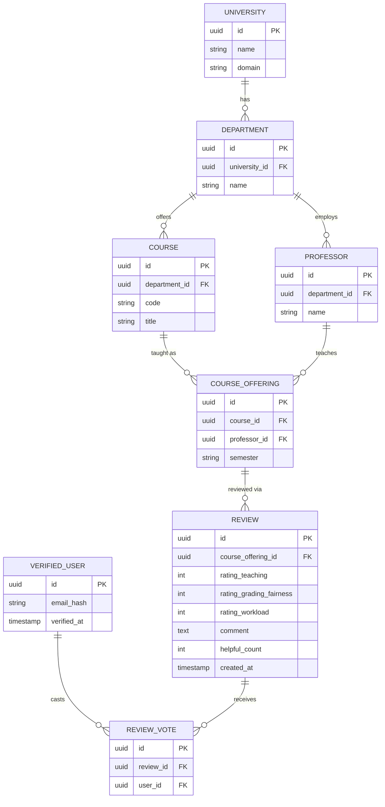
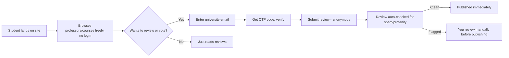

# SirKaisaHai — Project Documentation
### Anonymous Course & Professor Review Platform for Pakistani University Students

**Built by:** Solo student developer (BSCS, 3rd year)
**Scope:** Realistic solo/small-team student project — buildable in a semester, hostable for free/near-free
**Status:** Planning document, v1

> This is scoped for one person building this alongside a full course load, not a funded startup. No enterprise stuff, no things you won't actually build. If it grows later, you add complexity then — not now.

---

## 1. What This Is

A website where verified students at a university can anonymously write and read reviews of professors and courses — ratings + short text, searchable by professor or course name.

**The problem it solves:** Right now this info lives in scattered WhatsApp groups. A freshman or transfer student has no way to find out "is this professor's grading fair" or "is this course a lot of workload" before registering. Seniors know this stuff informally; new students don't.

**Who it's for:** Students at your own university first (Superior), expanding to other universities only if it actually gets traction.

---

## 2. Realistic Goals

Be honest about what "success" looks like at your scale:

- **Goal 1:** Get 100+ real students at Superior to sign up and leave at least one review within the first semester.
- **Goal 2:** Have every popular/commonly-taken course have at least 3 reviews.
- **Goal 3:** It becomes something students actually mention in WhatsApp groups without you promoting it.
- **Goal 4 (stretch):** One other university's students start using it organically.

You are not trying to hit "millions of users" or "99.9% uptime" — you're trying to prove one campus finds it useful. Don't build for scale you don't have yet.

---

## 3. Core Features (MVP — this is basically the whole build)

This is everything you actually need for v1. Nothing here should take more than a weekend each if you're focused.

| Feature | What it does | Why it's needed |
|---|---|---|
| Student email verification | Send OTP to `@superior.edu.pk`-style email before allowing a review | Keeps out randoms, builds trust in reviews |
| Browse professors/courses | List + search by name or department | Core way people find info |
| Submit a review | Ratings (teaching, grading fairness, workload, attendance) + short text | The core content of the app |
| Anonymous by design | Review is never linked back to the account that posted it, even in your own database | This is the whole trust promise of the app |
| One review per person per course | Stop spam/fake stacking | Keeps data honest |
| Upvote "helpful" | Simple quality signal, sort reviews by it | Makes good reviews rise to top |
| Basic profanity/spam filter | Auto-block obvious garbage before it's public | You can't manually moderate everything alone |
|AI-generated summaries| AI tries to identify the key points and creates short summaries for each review| This is useful for students who want to quickly get the gist of the reviews|

**Deliberately NOT in v1** (add later if the app actually takes off):
- Multi-university self-serve onboarding — you're one campus for now, add unis manually if it spreads
- Notifications, "follow a professor," planner tools — nice-to-haves, not core loop
- Admin dashboard UI — for v1, you can moderate flagged content directly in the database or a tiny internal script
- Mobile app — a responsive website is enough, no need for a native app yet

---

## 4. Tech Stack (Simple, Free-Tier Friendly)

You already know this stack from your other projects — no new tools to learn.

| Layer | Choice | Why |
|---|---|---|
| Backend | FastAPI (Python) | You already know it, async is fine for this scale |
| Database | PostgreSQL (free tier on Railway/Supabase) | Handles the "who reviewed what" constraint cleanly, free tier is plenty for one campus |
| Frontend | Next.js or Vue 3 | Whichever you're faster in — doesn't matter for this scale |
| Email/OTP | Just use a free transactional email service (Resend/Brevo free tier) | No need to build your own email infra |
| Hosting (frontend) | Vercel free tier | Zero-config, free |
| Hosting (backend) | Railway free tier | Comes with managed Postgres, easy |
| Caching/queue | Skip it for v1 | You don't have the traffic to need Redis yet — add it only if things get slow |

**What you're skipping on purpose (and that's correct):** CDN setup, background job workers, message queues, observability stacks (Sentry/Grafana), vector databases, multi-tenancy. All of that is solving problems you don't have yet. Add them when you actually hit a wall, not before.

---

## 5. Database — Just the Tables You Need

**The one important trick (this is the whole "anonymous" part):**

When someone submits a review, you check "has this user already reviewed this course" using a temporary link — then you throw that link away right after saving the review. So the `REVIEW` table has zero connection back to `VERIFIED_USER`. Not even you, looking directly at the database, can tell who wrote a specific review. That's what makes people trust it enough to be honest.

Practically: keep a separate small table like `review_submission_log (user_id, course_offering_id, submitted_at)` just to enforce "one review per person per course" — but never store the actual review text linked to a user ID anywhere.

---

## 6. Core Flow (How It Actually Works)

---

## 7. Pages You Actually Need to Build

1. **Home/Landing** — search bar, short explainer, "verify your email" CTA
2. **Auth (email + OTP)** — one simple form, two steps
3. **Professor Page** — name, average ratings, list of reviews, "write a review" button
4. **Course Page** — same idea, but per course instead of per professor
5. **Search Results** — simple list, filter by department
6. **Submit Review Form** — pick course + professor, fill ratings + text, submit

That's it. Six pages. Everything else (settings, notifications, admin dashboard) can wait.

---

## 8. Basic Security — What You Actually Need to Get Right

- Verify university email before allowing a review (OTP, 10-min expiry)
- Never store raw review text linked to a user ID (see §5)
- Don't log IP addresses next to review submissions
- Sanitize/escape all user text before displaying it (basic XSS protection — most frameworks do this by default, just don't turn it off)
- Use parameterized queries / an ORM, never raw string-concatenated SQL
- Rate-limit review submission (e.g. max 5 reviews a day per account) to stop spam
- Passwords: you don't need any — OTP-only login means no passwords to leak

You don't need: encryption-at-rest configuration, disaster recovery plans, SOC2, audit logs. Those matter when you have real users' sensitive data and legal exposure at scale — not for a campus MVP.

---

## 9. Realistic Build Plan (Solo, Around Classes)

| Phase | What you build | Rough time |
|---|---|---|
| Week 1-2 | DB schema + FastAPI backend skeleton, seed Superior's departments/courses/professors manually | 1-2 weeks |
| Week 3 | Email OTP auth flow | 3-5 days |
| Week 4 | Review submission + anonymity-preserving logic | 3-5 days |
| Week 5 | Professor/course pages + search on frontend | 1 week |
| Week 6 | Spam/profanity filter, basic polish, deploy | 3-5 days |
| Week 7 | Seed 15-20 real reviews yourself (ask friends), soft-launch to your own batch | ongoing |

Roughly a semester's worth of weekends, not months of full-time work. Adjust based on how much time you actually have around coursework.

---

## 10. What to Add Later (Only If It Takes Off)

Don't build these now — this is just so you know the growth path exists:

- Multi-university onboarding
- Notifications / follow professor
- Proper admin dashboard instead of manual DB checks
- Caching (Redis) once traffic actually gets slow
- Rebrand/rename if it spreads beyond your campus and "SirKaisaHai" needs to feel more universal

---

## 11. Non-Negotiable Rules for Yourself While Building

- Never write a database query that joins reviews back to a user's identity — this is the one thing that would break the entire trust of the product if it leaked.
- Never hardcode your API keys/secrets in code — use a `.env` file, and don't commit it.
- Keep the review form simple — every extra required field is a reason someone abandons writing a review.
- Seed real content before you show this to anyone — an empty review site convinces nobody.
- Don't over-engineer. If a free-tier tool does the job, use it. You can always upgrade later once there's real traffic.

---

*This is a working document — update it as you actually build and things change. Don't treat it as fixed in stone.*
